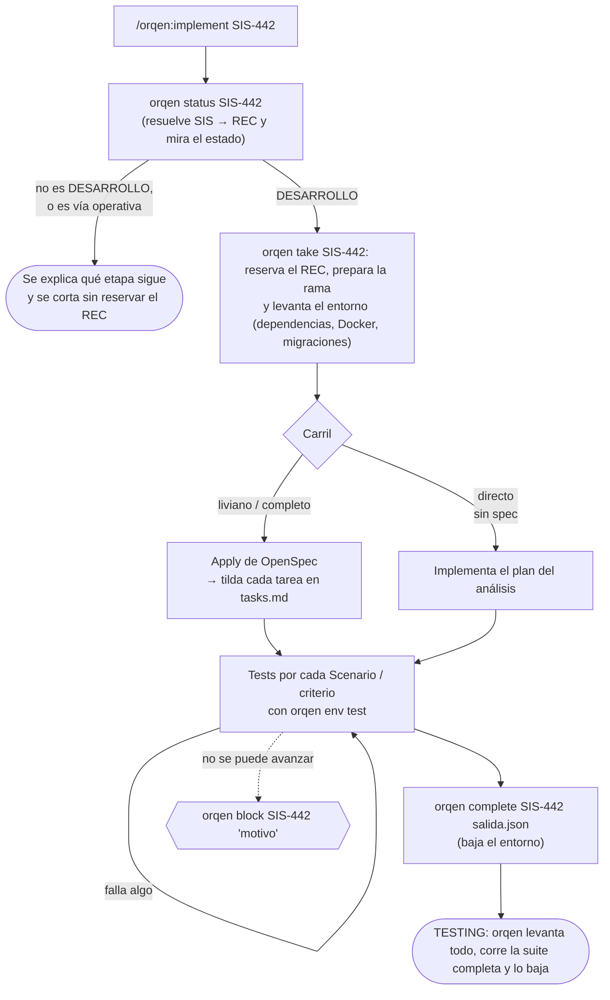
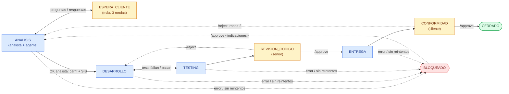

# orqen — AI Software Factory KIT

**orqen** es un kit de orquestación multiagente y automatización del desarrollo de software, diseñado para coordinar el ciclo de vida de los proyectos desde la definición de requerimientos hasta su implementación y despliegue.

Construido como una capa superior a OpenSpec, propone integrar agentes especializados de inteligencia artificial, repositorios de código, herramientas de desarrollo, reglas de ingeniería y bases de conocimiento en un ecosistema unificado.

Su arquitectura busca permitir que múltiples agentes colaboren de manera coordinada en actividades de análisis, planificación, desarrollo, pruebas, validación y mantenimiento, bajo mecanismos de gobernanza, supervisión y trazabilidad.

Uno de sus pilares es el aprendizaje continuo a partir de la experiencia: aprovechar los resultados de desarrollos anteriores para enriquecer una base de conocimiento reutilizable y mejorar progresivamente los procesos de trabajo.

## Uso

```sh
pnpm add -g orqen          # o: npm i -g orqen   (Node ≥ 20.12)
cd mi-repo
orqen init                 # stack + entornos con IA, OpenSpec, Jira y el kit
```

Después, en Claude Code (una vez por persona): `/plugin marketplace add ./` y `/plugin install orqen@orqen`.

| Quién | Qué |
|---|---|
| Analista | `/orqen:analyze REC-1234`: grilling con el agente → carril → spec (si corresponde) → SIS en Jira |
| Agente | `/orqen:implement SIS-442`: implementa con el entorno ya levantado (DB, servicios, migraciones) |
| Desatendido | `orqen cycle --loop`: avanza los gates y lanza el agente en cada etapa pendiente (nunca el análisis) |
| Personas en Jira | `/approve` o `/reject <motivo>` en los gates (revisión de código, conformidad, ejecución operativa) |

Para traer cambios del kit, de OpenSpec o de la CLI: `orqen update`.

## Comandos

```
orqen init [dir]                      Inicializa orqen en el repo   (--yes --no-ai --deep --agent "<cmd>" --tools a,b --no-openspec --no-animation)
orqen update [dir]                    Actualiza la CLI, OpenSpec y el kit   (--yes --no-cli --no-openspec --no-kit)

orqen env setup                       Instala dependencias
orqen env up [--apps]                 Servicios con healthcheck + migraciones + seed (--apps: también las apps)
orqen env test [unitarios|integracion|e2e|visual]
orqen env status | down

orqen pending [--json]                REC con trabajo: para analista y para agente
orqen analyze <KEY> [--analyst N]     Abre el análisis (lo usa /orqen:analyze)
orqen lane <KEY> <directo|liviano|completo>
orqen take <KEY> [--agent N]          Reserva la etapa, prepara la rama y levanta el entorno (lo usa /orqen:implement)
orqen complete <KEY> <salida.json|->  Valida la salida y avanza el proceso (baja el entorno)
orqen status [KEY] · schema <ETAPA> · block <KEY> <motivo> · release <KEY> · search <JQL>
orqen cycle [--loop]                  Modo desatendido
```

`take`, `complete`, `status`, `block` y `release` aceptan la key del REC o la de su SIS.

## Qué deja `orqen init` en cada repo

```
mi-repo/
├── orqen/
│   ├── config.yaml          stack, entornos (servicios, migraciones, tests), rama base, agente
│   ├── .env                 Jira, SIS, aprobadores (lo pide init; no se commitea)
│   ├── stages/              guías de cada etapa (editables)
│   ├── plugin/              plugin de Claude Code: /orqen:analyze, /orqen:implement, skill grilling
│   ├── work/<KEY>/          registro de cada REC: estado.json, bitacora.md, ronda-N/analisis.md
│   ├── state/  tmp/         estado operativo y temporales (ignorados por git)
│   └── manifest.json        lo que escribió orqen (para que `update` no pise lo que editó el equipo)
├── docker-compose.orqen.yml servicios con healthcheck; las apps en el perfil "apps"
├── AGENTS.md                bloque <!-- orqen:inicio/fin --> con el proceso; el resto es del equipo
├── CLAUDE.md                @AGENTS.md
└── openspec/                OpenSpec, con las reglas del proceso REC en config.yaml
```

## Análisis: `/orqen:analyze REC-1234`


El agente **no escribe en Jira** (el MCP es solo lectura): la creación del SIS, el vínculo `SIS ↔ REC`, los comentarios y los
labels los hace `orqen` en `complete`, solo si el análisis tiene el OK del analista y la spec (si hay) valida.

### Carriles

| Carril            | Cuándo (guía; ajustable en `orqen/stages/analisis.md`)                                 | Qué se genera                                                                                            |
| ----------------- | -------------------------------------------------------------------------------------- | -------------------------------------------------------------------------------------------------------- |
| `directo`         | Un componente, ≲ 4 h, sin cambio de contrato, bajo riesgo                              | **Sin OpenSpec.** `plan` + criterios de aceptación en el análisis y el SIS. Testing contra los criterios |
| `liviano`         | Comportamiento observable acotado, 1–2 capacidades, ≲ 2 días                           | Change de OpenSpec compacto: proposal + deltas + tasks (design mínimo)                                   |
| `completo`        | Varias capacidades, datos/integraciones, seguridad/facturación, > 2 días, arquitectura | Change completo: proposal + specs + design + tasks                                                       |
| operativa (`via`) | Se resuelve sin cambiar código (SQL, datos, reinicio, config)                          | Sin spec ni rama; flujo EJECUCION → aprobación → aplicación → verificación                               |

## Implementación: `/orqen:implement SIS-442`



Nadie corre `orqen env …` a mano durante el proceso: `take` levanta el entorno, `complete` lo baja y en TESTING orqen levanta
todo (también las apps), corre todos los tests de `orqen/config.yaml` y lo baja.

## Flujo completo



**Azul**: etapas del agente · **Amarillo**: gates humanos en Jira · **Rojo**: bloqueado (lo destraba una persona).
Jira, git, PR y `openspec archive` los ejecuta solo `orqen`; el agente produce contenido.

## Garantías y límites

- Las salidas se validan con zod y con OpenSpec. Si algo no cumple, el agente recibe la lista de errores y reintenta. Nada avanza a medias:
  el SIS no se crea hasta que el análisis (y la spec) están validados, y si Jira falla a mitad de camino, repetir `complete` retoma sin duplicar.
- El OK del analista es un campo obligatorio de la salida (`analista_ok`), pero **lo declara el agente**: es una barrera de proceso, no de seguridad.
- Jira, git, PR y archive los ejecuta **solo** `orqen`. El agente tiene esa prohibición en `AGENTS.md`, pero no hay un hook que lo impida
  a la fuerza: reforzalo con los permisos de cada herramienta (por ejemplo, denegar `git push` en `.claude/settings.json`).
- Usa un solo checkout: procesa un REC por vez por clon. Para trabajar en paralelo, un clon o worktree por agente.

## Este repo

```
packages/
├── cli/    orqen (la CLI): init, update, env y el proceso REC   → packages/cli/README.md
└── kit/    orqen-kit: lo que init instala en cada repo (AGENTS.md, etapas, plugin, reglas de OpenSpec)
```

```sh
pnpm install
pnpm enlazar          # build + npm link: deja `orqen` global apuntando a este código
pnpm test             # 38 tests: detección, compose, kit, agente, proceso REC (OpenSpec y git reales), entornos
pnpm typecheck
```

Publicar (paquetes públicos `orqen` y `orqen-kit`): subir `version` en `packages/*/package.json`, y
`npm login && pnpm build && pnpm -r publish --access public`.
