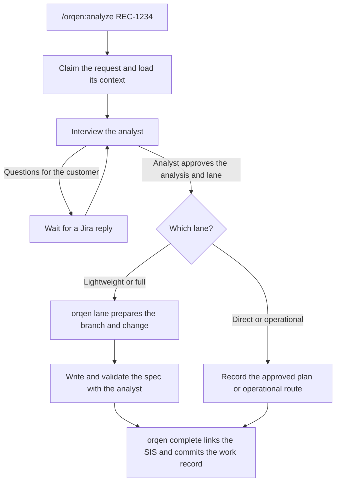
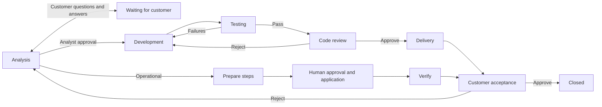

# orqen — AI Software Factory Kit

**orqen** coordinates AI agents and development workflows from customer requirements through implementation and delivery. It builds on OpenSpec, using repository specifications and Jira issues to track decisions, verification, and approvals.

## Quick start

```sh
pnpm add -g orqen          # or: npm i -g orqen (Node >= 20.12)
cd my-repo
orqen init
```

In Claude Code, run `/plugin marketplace add ./` and `/plugin install orqen@orqen` once per user.

| Who | What they run |
| --- | --- |
| Analyst | `/orqen:analyze REC-1234` to review a request, choose a lane, write a spec when needed, and create a Jira implementation issue |
| Agent | `/orqen:implement SIS-442` to implement the approved spec or plan |
| Unattended runner | `orqen cycle --loop` to check for approvals and dispatch eligible stages |
| Jira reviewers | `/approve` or `/reject <reason>` on the issue |

## Commands

```text
orqen init [dir]                       Initialize a repository
orqen update [dir]                     Update the CLI, OpenSpec, and kit

orqen env setup                        Install dependencies
orqen env up [--apps]                  Start services, run migrations, and seed data
orqen env test [unitarios|integracion|e2e|visual]
orqen env status
orqen env down

orqen pending [--json]                 List requests awaiting analyst or agent work
orqen analyze <KEY> [--analyst NAME]   Start analysis
orqen lane <KEY> <direct|light|full>
orqen take <KEY> [--agent NAME]        Claim a stage and prepare its environment
orqen complete <KEY> <output.json|->  Validate the output and advance the workflow
orqen status [KEY]
orqen schema <STAGE>
orqen block <KEY> <reason>
orqen release <KEY>
orqen search <JQL>
orqen pr <KEY> [<explanation.md>] [--title TITLE]
orqen cycle [--loop]                   Run the unattended workflow
```

`take`, `complete`, `status`, `block`, and `release` accept either the customer request key (REC) or its linked implementation issue key (SIS). Run `orqen schema <STAGE>` to inspect the accepted JSON fields.

## Repository setup

| Path | Purpose |
| --- | --- |
| `orqen/config.yaml` | Stack, services, migrations, tests, base branch, and agent settings |
| `orqen/.env` | Local Jira credentials, project settings, and approvers |
| `orqen/stages/` | Editable stage instructions |
| `orqen/plugin/` | Claude Code commands and the grilling skill |
| `orqen/work/<KEY>/` | Request history, including `state.json`, `log.md`, and analysis notes |
| `orqen/state/` and `orqen/tmp/` | Local workflow state and temporary files |
| `orqen/manifest.json` | File hashes used by `orqen update` to identify local edits |
| `docker-compose.orqen.yml` | Services with health checks and optional apps under the `apps` profile |
| `AGENTS.md` and `CLAUDE.md` | Workflow instructions for agents |
| `openspec/` | Specifications and the OpenSpec configuration |

## From request to delivery

The analyst reviews the Jira issue and repository with the agent, confirms the acceptance criteria, and selects a lane. Questions only the customer can answer send the request to `WAITING_CLIENT` (Waiting for customer).

| Lane | When to use it | Output |
| --- | --- | --- |
| `direct` (direct) | A low-risk change in one component, roughly four hours or less, with no contract change | An implementation plan and acceptance criteria |
| `light` (lightweight) | A focused behavior change across one or two capabilities, roughly two days or less | An OpenSpec proposal, spec deltas, a short design, and tasks |
| `full` (full) | Larger changes involving architecture, data, integration, security, or billing | A full OpenSpec proposal, specs, design, and tasks |
| `route: operational` (operational) | A data, service, or configuration change with no code changes | Steps, rollback, and read-only verification. A person approves and applies the change |

For the lightweight and full lanes, `orqen lane` prepares the branch and OpenSpec change. After the analyst approves and the analysis passes validation, `orqen complete` creates and links the SIS and writes the request record.



`/orqen:implement SIS-442` checks the linked request's stage before claiming it. In development, the agent applies the OpenSpec change and checks off each task in `tasks.md`, or follows the direct lane's approved plan. It runs tests for each criterion, submits the stage JSON with `orqen complete`, and hands off to the testing stage.



During development, `orqen take` starts the environment and `orqen complete` shuts it down. During testing, orqen starts the full environment, runs the configured suite, and shuts it down. Agents may run individual tests using `orqen env test`.

## Guarantees and limits

- Stage outputs are validated with Zod and, when applicable, OpenSpec. If Jira fails partway through closing analysis, retrying `complete` resumes the operation without creating a duplicate SIS.
- The agent records analyst approval in the required `analyst_ok` field. This is a workflow check. Use tool permissions to enforce Git and Jira access.
- orqen manages Jira writes, branch transitions, pull requests, and OpenSpec archiving. Agents write stage outputs and implement approved changes.
- Each checkout handles one request at a time. Use separate clones or worktrees for parallel work.

## Develop and publish

- [CLI](cli/README.md) contains the commands and the request workflow.
- `template/` contains the files installed by `orqen init`.

```sh
cd cli
npm ci
npm run dev -- --help
npm test
npm run typecheck
npm run build
```

Run `npm run setup` from `cli/` to link the local build as `orqen`. The published `orqen` package includes the templates. The release workflow publishes from `cli/` when a version tag is pushed.
