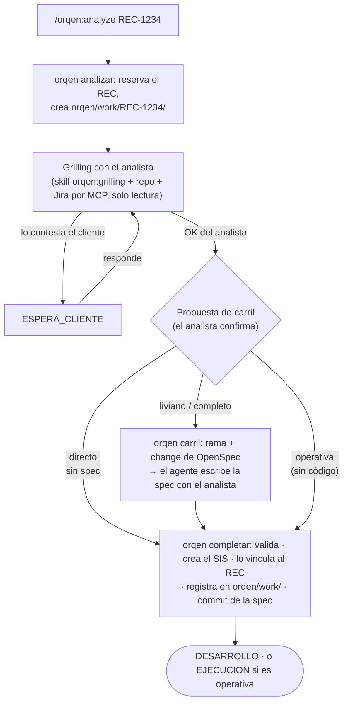
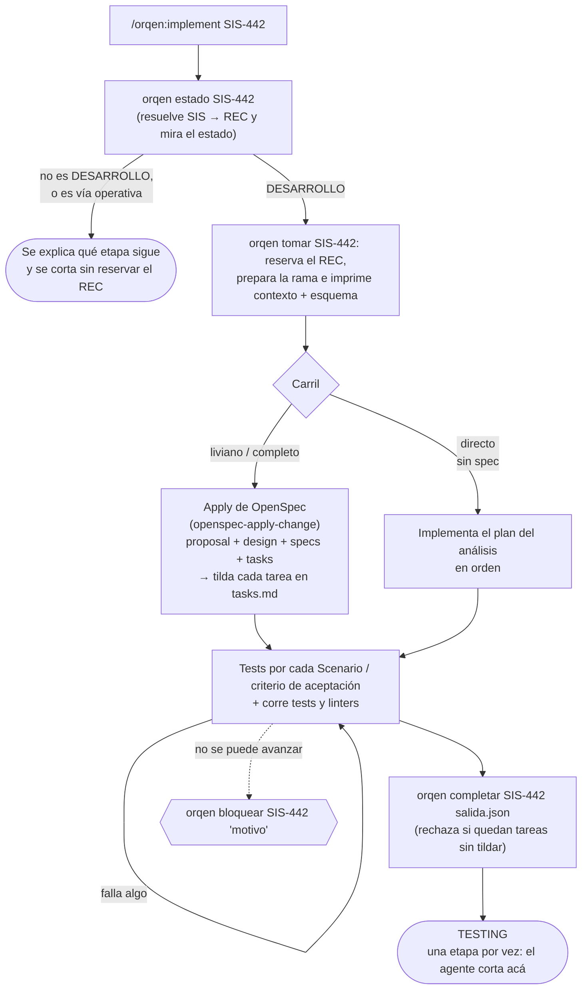
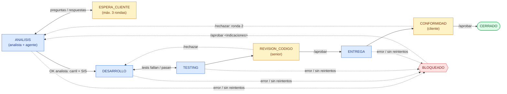

# orqen — AI Software Factory KIT

**orqen** es un kit de orquestación multiagente y automatización del desarrollo de software, diseñado para coordinar el ciclo de vida de los proyectos desde la definición de requerimientos hasta su implementación y despliegue.

Construido como una capa superior a OpenSpec, propone integrar agentes especializados de inteligencia artificial, repositorios de código, herramientas de desarrollo, reglas de ingeniería y bases de conocimiento en un ecosistema unificado.

Su arquitectura busca permitir que múltiples agentes colaboren de manera coordinada en actividades de análisis, planificación, desarrollo, pruebas, validación y mantenimiento, bajo mecanismos de gobernanza, supervisión y trazabilidad.

Uno de sus pilares es el aprendizaje continuo a partir de la experiencia: aprovechar los resultados de desarrollos anteriores para enriquecer una base de conocimiento reutilizable y mejorar progresivamente los procesos de trabajo.

El análisis lo conduce un **analista** con el agente (`/orqen:analyze REC-1234`); el resto lo lleva el agente con aprobaciones humanas.

- **`AGENTS.md`**: lo que el agente lee. Explica el proceso y las reglas, y le dice que use la CLI `cli`.
- **`cli/`**: CLI en TypeScript (Node ≥ 20.12) que maneja la máquina de estados, Jira, git, tests y OpenSpec.
  Es determinística: el agente produce contenido y `cli` decide el flujo.
- **`orqen/`**: plugin de Claude Code con los comandos `/orqen:analyze` y `/orqen:implement`, y el skill `orqen:grilling`.
- **`orqen/work/<KEY>/`**: registro y estado de cada REC dentro del repo (lo escribe `orqen`).
- **`openspec/config.yaml`**: reglas del proceso REC aplicadas a los artefactos de OpenSpec.

## Análisis: `/orqen:analyze REC-1234`



El agente **no escribe en Jira** (el MCP es solo lectura): la creación del SIS, el vínculo `SIS ↔ REC`, los comentarios y los
labels los hace `orqen` en `completar`, solo si el análisis tiene el OK del analista y la spec (si hay) valida.

### Carriles

| Carril            | Cuándo (guía; ajustable en `cli/etapas/analisis.md`)                                   | Qué se genera                                                                                            |
| ----------------- | -------------------------------------------------------------------------------------- | -------------------------------------------------------------------------------------------------------- |
| `directo`         | Un componente, ≲ 4 h, sin cambio de contrato, bajo riesgo                              | **Sin OpenSpec.** `plan` + criterios de aceptación en el análisis y el SIS. Testing contra los criterios |
| `liviano`         | Comportamiento observable acotado, 1–2 capacidades, ≲ 2 días                           | Change de OpenSpec compacto: proposal + deltas + tasks (design mínimo)                                   |
| `completo`        | Varias capacidades, datos/integraciones, seguridad/facturación, > 2 días, arquitectura | Change completo: proposal + specs + design + tasks                                                       |
| operativa (`via`) | Se resuelve sin cambiar código (SQL, datos, reinicio, config)                          | Sin spec ni rama; flujo EJECUCION → aprobación → aplicación → verificación                               |

### Qué queda en `orqen/work/REC-1234/`

```
orqen/work/REC-1234/
├── estado.json            proyección del estado (estado, carril, SIS, rama, change, analista)
├── bitacora.md            una línea por transición
└── ronda-1/
    ├── analisis.md        resumen, criterios, decisiones del grilling, carril y justificación, SIS, estimación
    ├── analisis.json      la salida validada de la etapa
    └── ejecucion/         (solo carril operativo) script.sql, pasos, rollback, verificación
```

Se commitea con la rama del REC (`cli` commitea el registro en cada transición mientras esa rama está activa), así la
trazabilidad viaja con el código y la spec. La **fuente de verdad operativa** sigue en `cli/.estado/` (ignorado por git);
`orqen/` es la proyección legible. Cada ronda nueva (rechazo de conformidad) agrega `ronda-2/`, etc.

## Implementación: `/orqen:implement SIS-442`

Toma el SIS que creó el análisis y ejecuta la etapa **DESARROLLO**: aplica la spec de OpenSpec si el carril la tiene
(`liviano` / `completo`) o sigue el `plan` del análisis (`directo`). Acepta la key del SIS o la del REC; `cli` resuelve a qué REC
pertenece (el SIS vigente de la ronda actual).



Mismas reglas que el análisis: Jira de solo lectura para el agente, sin `git commit/push/checkout`, sin `openspec archive`
y sin tocar `cli/.estado/`, `orqen/work/` ni los scripts de `cli/`. Si el contexto trae un test fallido o un rechazo de revisión,
se corrige eso primero.

## Flujo completo



**Azul**: etapas del agente · **Amarillo**: gates humanos en Jira · **Rojo**: bloqueado (lo destraba una persona).
Jira, git, PR y `openspec archive` los ejecuta solo `orqen`; el agente produce contenido.
Desaparecieron los gates `APROBACION_ANALISIS` y `APROBACION_SPEC`: el OK del analista en el grilling los reemplaza
(y por eso `APROBADORES_SPEC` ya no existe).

| Estado          | Quién             | Qué pasa                                                                                                   | OpenSpec                                                                                                                                                     |
| --------------- | ----------------- | ---------------------------------------------------------------------------------------------------------- | ------------------------------------------------------------------------------------------------------------------------------------------------------------ |
| ANALISIS        | analista + agente | grilling → OK → carril → spec (si corresponde) → SIS vinculado al REC                                      | lee `openspec/specs`; liviano/completo: `orqen carril` crea el change y `orqen completar` exige `validate --strict`, artefactos completos y `(Nh)` en cada tarea |
| ESPERA_CLIENTE  | cliente           | responde en Jira (máx. 3 rondas)                                                                           | —                                                                                                                                                            |
| DESARROLLO      | agente            | implementa; con spec tilda `tasks.md`, en directo sigue el `plan`                                          | flujo _apply_; `orqen` rechaza si queda alguna tarea sin tildar                                                                                                |
| TESTING         | `orqen` + agente    | `orqen` corre la suite y el agente mapea test ↔ **cada Scenario** (directo: cada **criterio de aceptación**) | si falta alguno, se rechaza                                                                                                                                  |
| REVISION_CODIGO | senior            | revisa el PR (cuerpo = `proposal.md`, o `analisis.md` en directo)                                          | —                                                                                                                                                            |
| ENTREGA         | `orqen` + agente    | `orqen` archiva (si hubo spec) y el agente escribe notas y mensaje al cliente                                | `openspec archive` fusiona los deltas en `openspec/specs` dentro del mismo PR                                                                                |
| CONFORMIDAD     | cliente           | `/aprobar` cierra; `/rechazar` abre la ronda 2 (vuelve a ANALISIS: nuevo carril, change y SIS)             | nuevo change `…-r2`                                                                                                                                          |

Si se agotan los reintentos o hay un error, el REC pasa a **BLOQUEADO**. Una persona destraba con `/aprobar <indicaciones>`
(`APROBADORES_ANALISIS` + `APROBADORES_CODIGO`).

## Instalación en un repo

```sh
# 1. copiar AGENTS.md (o fusionarlo con el existente), CLAUDE.md, cli/ y orqen/ en la raíz del repo
npm ci --prefix cli
npm i -g @fission-ai/openspec            # o definir OPENSPEC_CMD
openspec init --tools claude,codex,cursor --language es   # elegí las herramientas del equipo
#    → después fusioná template/openspec/config.yaml con openspec/config.yaml
cp cli/.env.example cli/.env              # Jira, SIS, aprobadores, comando de tests, AGENTE_CMD
echo "cli/.estado/" >> .gitignore         # orqen/work/ NO se ignora: es el registro versionado
```

**Plugin para Claude Code** (da `/orqen:analyze`, `/orqen:implement` y el skill de grilling), una vez por analista:

```
/plugin marketplace add ./          # raíz de este repo (tiene .claude-plugin/marketplace.json); o la URL git del kit
/plugin install orqen@orqen
```

Recomendado: conectar también el MCP de Atlassian/Jira para que el grilling lea el REC y los relacionados. Es solo lectura:
las escrituras las hace `orqen` con `JIRA_TOKEN`. `openspec init --tools …` instala los skills/comandos de OpenSpec
(_propose_, _apply_…) y las guías de etapa los usan si existen (si no, recurren a `openspec instructions`).

## Uso

**Análisis (analista)**: en Claude Code, `/orqen:analyze REC-1234`. En otro agente: _"analizá el REC-1234"_ (el agente lee
`AGENTS.md` y corre `orqen analizar` → grilling → `orqen carril` → `orqen completar`).

**Implementación**: en Claude Code, `/orqen:implement SIS-442`. En otro agente: _"implementá el SIS-442"_ (`orqen estado` → `orqen tomar` →
apply de la spec o plan → `orqen completar`). `tomar`, `completar`, `estado`, `bloquear` y `liberar` aceptan la key del SIS o la del REC.

**Resto de las etapas, interactivo**: _"procesá el REC REC-123"_ → `orqen tomar` → trabaja → `orqen completar`.

**Desatendido** (cron, CI o servidor), solo etapas de agente — **nunca** ANALISIS:

```sh
./cli/bin/orqen ciclo --loop     # cada REC_INTERVALO_SEG: avanza gates y lanza AGENTE_CMD por REC pendiente
```

Para cambiar de agente alcanza con cambiar `AGENTE_CMD`, por ejemplo a `codex exec --full-auto {prompt}`.

Otros comandos: `orqen pendientes` (separa _para analizar_ de _para un agente_), `orqen estado [KEY]`, `orqen esquema <ETAPA>`,
`orqen bloquear`, `orqen liberar`, `orqen buscar <JQL>`. Los REC nuevos ya no se toman solos: quedan en NUEVO hasta que un analista corre `analizar`.

## Garantías y límites

- Las salidas se validan con zod y con OpenSpec. Si algo no cumple, el agente recibe la lista de errores y reintenta. Nada avanza a medias:
  el SIS no se crea hasta que el análisis (y la spec) están validados, y si Jira falla a mitad de camino, repetir `completar` retoma sin duplicar.
- El OK del analista es un campo obligatorio de la salida (`analista_ok`), pero **lo declara el agente**: `orqen` no puede comprobar que la persona
  lo haya dado. Es una barrera de proceso, no de seguridad.
- Hay un lock por REC (vence a los `REC_LOCK_MIN`, pero el mismo agente puede completar igual si nadie más lo tomó, porque el grilling puede ser largo).
- Jira, git, PR y archive los ejecuta **solo** `orqen`. El agente tiene esa prohibición en `AGENTS.md`, pero
  al ser agnóstico **no hay un hook que lo impida a la fuerza**. Hay que reforzarlo con el sandbox o los permisos de
  cada herramienta (por ejemplo, denegar `git push` en `.claude/settings.json`, o permitir del MCP de Jira solo las herramientas de lectura).
- El estado vive en `cli/.estado/*.json` (ignorado por git, sobrevive a los cambios de rama) y en labels de Jira `rec-estado-*`; `orqen/work/<KEY>/` es su proyección versionada.
- Usa un solo checkout, así que procesa un REC por vez por clon. Para trabajar en paralelo: un clon o worktree por agente.

## Tests

```sh
cd cli && npm test        # e2e con OpenSpec y git reales + gates, carriles y SIS con fakes
npm run typecheck
```
