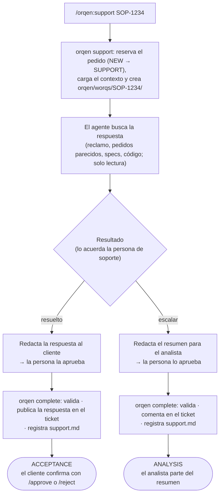
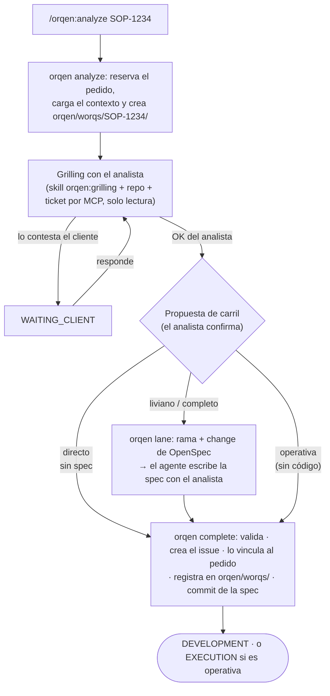
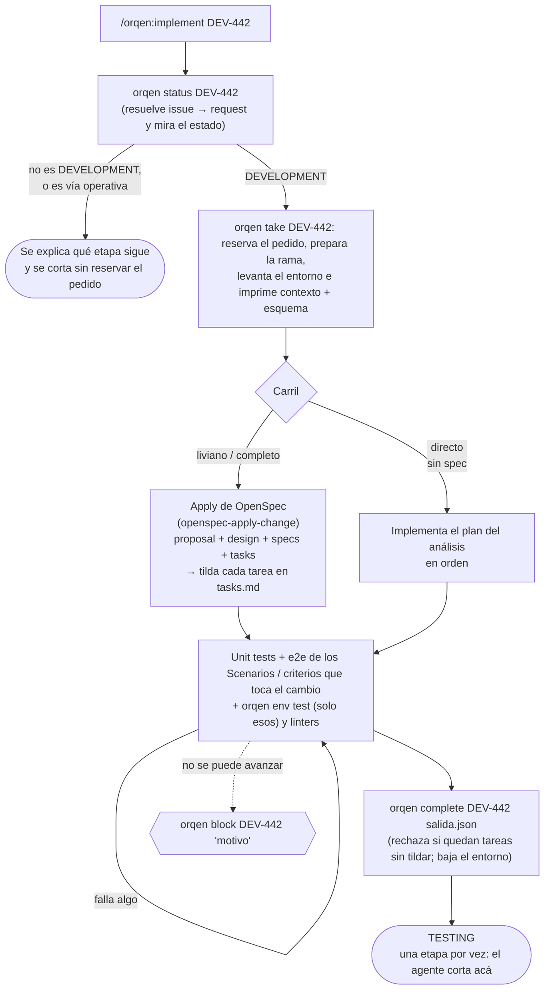
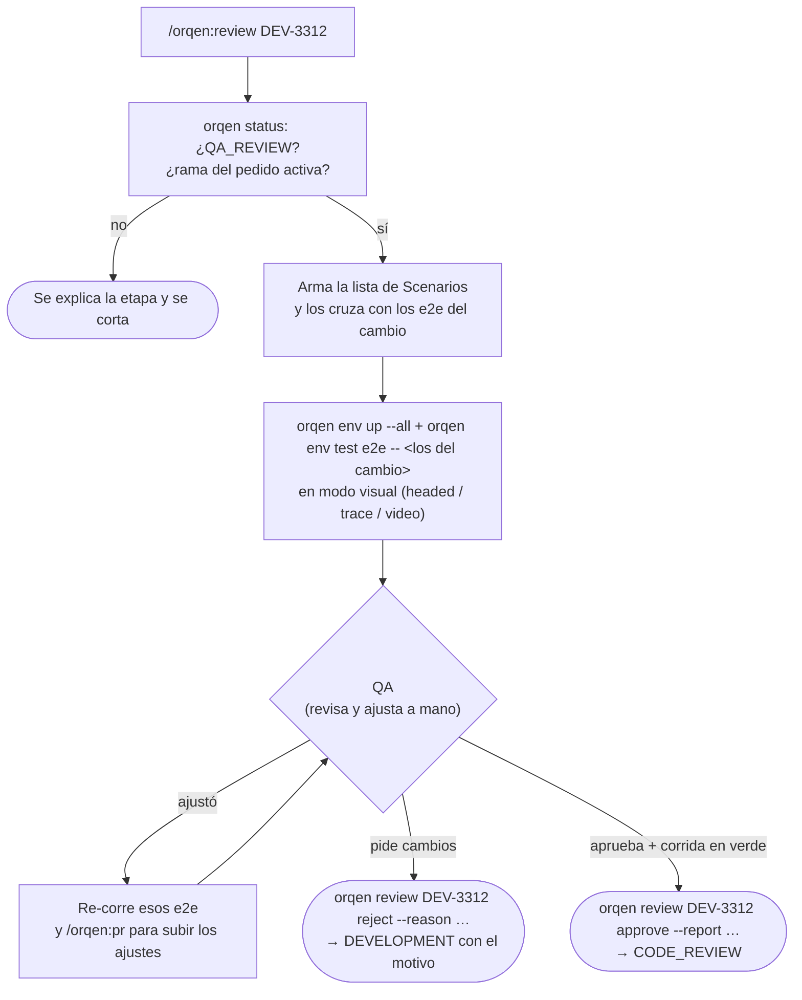
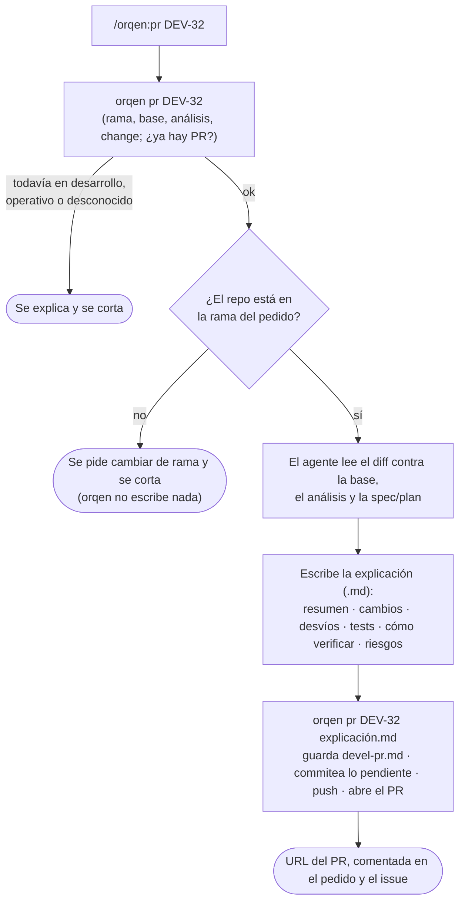
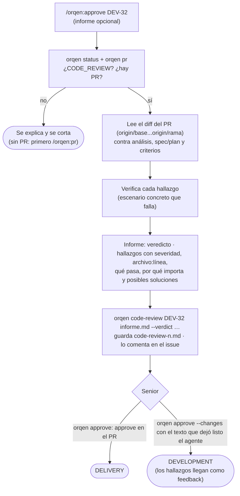
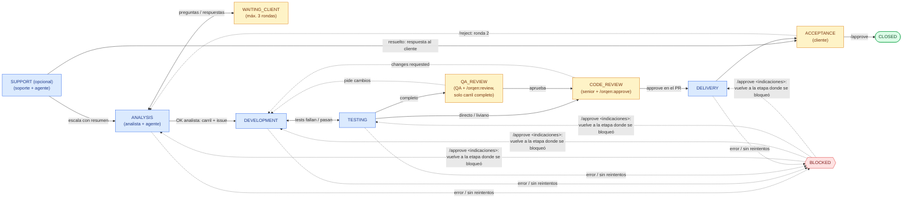

# orqen — AI Software Factory KIT

**orqen** es un kit de orquestación multiagente y automatización del desarrollo de software, diseñado para coordinar el ciclo de vida de los proyectos desde la definición de requerimientos hasta su implementación y entrega.

Construido como una capa superior a OpenSpec, integra agentes especializados de inteligencia artificial, repositorios de código, herramientas de desarrollo, reglas de ingeniería y bases de conocimiento en un ecosistema unificado.

Su arquitectura permite que múltiples agentes colaboren de manera coordinada en actividades de análisis, planificación, desarrollo, pruebas, validación y mantenimiento, bajo mecanismos de gobernanza, supervisión y trazabilidad.

Uno de sus pilares es el aprendizaje continuo a partir de la experiencia: aprovechar los resultados de desarrollos anteriores para enriquecer una base de conocimiento reutilizable y mejorar progresivamente los procesos de trabajo.

El flujo completo son **9 pasos**, uno por comando: `list requests` · `support` · `analyze` · `list issues` · `implement` · `pr` · `review` (QA, solo carril completo) · `list prs` · `approve` (senior). En la [app de escritorio](https://github.com/sistemas-telpin/orqen-gui), al elegir un pedido se abre una terminal para chatear con el agente con el comando que sigue ya sugerido.
Cada pedido que orqen toma es un **worq**, su unidad de trabajo: el request del cliente, su issue, la rama, la spec, el PR y el registro de cada etapa,
todo identificado por la clave del request y guardado en `orqen/worqs/<KEY>/`. `orqen worqs` los lista y `orqen worq <KEY>` muestra uno.
El recorrido completo, con los comandos `orqen`, las skills `/orqen:*` y qué hace cada una: [docs/flujo-paso-a-paso.md](docs/flujo-paso-a-paso.md).

Opcionalmente, una persona de **soporte** atiende primero el reclamo con el agente (`/orqen:support SOP-1234`) e intenta responderle al cliente. Si no alcanza, lo escala al analista. El análisis lo conduce un **analista** con el agente (`/orqen:analyze SOP-1234`); el resto lo lleva el agente con aprobaciones humanas.

| Quién              | Qué corre                                                                                                        |
| ------------------ | ---------------------------------------------------------------------------------------------------------------- |
| Persona nueva      | `/orqen:tutorial` (o `orqen tutorial` en la terminal): 12 pasos cortos, en el idioma del sistema, con qué correr en cada etapa, cómo avanza un pedido y cómo mirar al agente y los entornos |
| Soporte (opcional) | `/orqen:support SOP-1234`: busca la respuesta, la redacta para el cliente y, si no se puede resolver, escala al analista con un resumen |
| Analista           | `/orqen:analyze SOP-1234`: analiza el pedido, elige el carril, escribe la spec si hace falta y crea el issue (si hay)|
| Agente             | `/orqen:implement DEV-442`: implementa la spec o el plan aprobado y corre solo TESTING (la regresión completa) · `/orqen:pr DEV-442`: abre el PR a desarrollo |
| Todos              | `/orqen:list requests` (`orqen list requests`): la lista de trabajo por rol, sin tomar nada · desarrollo: `/orqen:list issues` · senior: `/orqen:list prs` |
| QA                 | `/orqen:review DEV-442`: solo carril completo, en `QA_REVIEW`; revisa en pantalla los e2e del cambio y aprueba (`orqen review … approve`) o pide cambios (vuelve a desarrollo) |
| Senior             | `/orqen:approve DEV-442`: informe opcional del PR, después aprueba o pide cambios (`orqen approve`, queda el review en el PR) y entrega al cliente |
| Modo desatendido   | `orqen cycle --loop`: avanza los gates y lanza las etapas de agente pendientes                                   |
| Aprobadores        | `/approve` o `/reject <motivo>` en el request (conformidad del cliente, carril operativo, destrabar un BLOCKED)    |

## Componentes

- **CLI `orqen`** (paquete npm, Node ≥ 20.12): maneja la máquina de estados, los tickets (conectores), git, los PRs, los entornos de prueba y OpenSpec.
  Es determinística: el agente produce contenido y `orqen` decide el flujo.
- **`AGENTS.md` / `CLAUDE.md`**: lo que lee el agente. Explican el proceso y las reglas, y le indican que use la CLI.
- **Plugin de Claude Code** (`orqen/plugin/`): los comandos `/orqen:tutorial`, `/orqen:support`, `/orqen:analyze`, `/orqen:list`, `/orqen:implement`, `/orqen:pr`, `/orqen:review` (QA), `/orqen:approve` (`/orqen:e2e-review` y `/orqen:code-review` quedan como nombres viejos que redirigen), y el skill `orqen:grilling`.
- **`orqen/stages/`**: las guías de cada etapa (soporte, análisis, especificación, desarrollo, testing, entrega, ejecución y verificación). Se pueden editar.
- **`orqen/worqs/<KEY>/`**: registro y estado de cada pedido dentro del repo (lo escribe `orqen`).
- **`openspec/config.yaml`**: reglas del proceso de pedidos aplicadas a los artefactos de OpenSpec.

## Tutorial para personas nuevas: `/orqen:tutorial`

Con el repo ya inicializado (`orqen init`), quien recién llega abre Claude Code en la carpeta y escribe `/orqen:tutorial`
(o `/orqen:tutorial env`, `/orqen:tutorial 4`… para ir directo a un paso). También anda sin Claude Code, en la terminal: `orqen tutorial`.

Son 12 pasos cortos, en palabras simples: bienvenida · 5 palabras que vas a escuchar · el camino de un pedido · **cómo se pasa a la etapa
siguiente** · ver qué hay para hacer · analizar · implementar · testing, PR y revisión · **mirar qué está haciendo el agente** ·
**mirar los entornos que levantó** · si algo sale mal · machete. Cada paso dice dónde se escribe cada cosa (`[Terminal]` o
`[Claude Code]`), qué va a pasar y cómo te das cuenta de que terminó.

- **El texto lo escribe orqen, no el agente**: está en la CLI (`cli/src/tutorial/content.ts`), así que es siempre el mismo y se puede corregir
  en un solo lugar. El comando de Claude Code corre `orqen tutorial --step <n> --json`, muestra el paso tal cual y ofrece los botones
  (siguiente, probalo, otro tema, salir). Si la persona pregunta algo, el agente contesta corto y vuelve al tutorial.
- **Con los datos del repo**: procesos, puertos y URLs de `orqen/environment.yaml`, claves de ejemplo según los conectores (Jira, GitHub o Asana), si hay soporte,
  cómo se decide el code review y el comando para seguir un log en PowerShell (Windows) o bash. Nunca muestra secretos de `orqen/.env`.
- **"Probalo ahora"** solo corre comandos de lectura (`orqen status`, `orqen list requests`, `orqen env status`, `git status`). Nunca toma ni cambia un pedido.

`orqen tutorial --list` lista los pasos y `orqen tutorial --step <n|id>` imprime uno.

## Idioma

orqen toma el idioma del sistema operativo: **español** si está en español, **inglés** para cualquier otro (en Windows, el idioma de
pantalla, `Get-UICulture`; en macOS, `AppleLanguages`; en Linux, `LC_ALL` / `LANG`). Se fuerza con `ORQEN_LANG=es` o `ORQEN_LANG=en`.

- El tutorial se muestra entero en ese idioma.
- Los agentes le hablan a la persona en ese idioma en todos los comandos `/orqen:*` (`orqen lang` lo imprime y el contexto de cada etapa lo trae
  como `language`). Comandos, estados y rutas quedan como están, y los artefactos (specs, salidas) siguen sus propias reglas.
- Los mensajes del resto de la CLI siguen en inglés.

## Soporte (opcional): `/orqen:support SOP-1234`

Es la etapa **antes del analista**: la persona que recibe el reclamo intenta responderle al cliente sin llegar a un análisis ni a
un desarrollo. `workflow.support` (en `orqen/config.yaml`, apagada por defecto) solo decide si `orqen list requests` manda los pedidos nuevos a soporte: con `on` aparecen primero ahí; con `off`, el flujo es el de siempre
(`NEW` → `ANALYSIS`).



**Quién y cómo.** La conduce una persona de soporte con el agente, igual que el análisis con el analista: el agente propone, la
persona decide. `orqen complete` rechaza la salida si falta el **OK explícito** de la persona (`support_ok`) sobre el resultado y sobre
el texto exacto que le llegará al cliente. No hay una lista de personas de soporte: puede tomarlo cualquiera.

| Resultado  | Cuándo                                                                                                                       | Qué pasa                                                                                                                                                       |
| ---------- | ---------------------------------------------------------------------------------------------------------------------------- | -------------------------------------------------------------------------------------------------------------------------------------------------------------- |
| `resolved` | Se responde sin tocar código, datos ni configuración: una consulta de uso, una causa y solución conocidas, algo ya documentado | `orqen` publica la respuesta y el pedido pasa a **ACCEPTANCE**. **No se crea issue.** Si el cliente hace `/reject <motivo>`, abre la ronda 2 y lo toma el analista |
| `escalate` | Pide algo nuevo, es un defecto que requiere código, una corrección de datos o de configuración, o no hay certeza de la respuesta | El pedido pasa a **ANALYSIS** con el `escalation_summary` (qué se sabe, qué se probó, qué falta). Se puede mandar además un acuse breve al cliente (opcional)    |

Ante la duda, **escalar**: una respuesta equivocada le cuesta una ronda al cliente; una escalación de más le cuesta unos minutos al
analista. El agente nunca promete fechas, alcance ni cambios al cliente.

**Qué no cambia.**

- El analista puede tomar un pedido `NEW` directamente con `orqen analyze`, sin pasar por soporte. También puede tomar uno en `SUPPORT`
  que nadie esté atendiendo; si hay una sesión de soporte activa, `orqen` se lo impide.
- El agente no escribe en el ticket: los comentarios los publica `orqen` en `complete`, solo con el OK de la persona.
- Es una etapa de persona: `orqen cycle` (modo desatendido) nunca la toma.

**Qué queda registrado.** `orqen/worqs/SOP-1234/round-1/support.md` (resultado, qué se revisó, respuesta al cliente y escalación) y
`support.json` (la salida validada). Cuando el analista abre el pedido escalado, recibe todo eso en `previous_stages.SUPPORT`, y la guía de
análisis le indica partir de ahí en vez de repetir el trabajo. La guía de la etapa está en `orqen/stages/support.md` y se puede editar.

`orqen list requests` lista los pedidos para soporte aparte de los del analista y los del agente. Un pedido resuelto por soporte no tiene rama, así que su
registro en `orqen/worqs/` no se commitea solo (como pasa con el carril operativo).

## Análisis: `/orqen:analyze SOP-1234`



El agente **no escribe en el ticket** (el MCP es solo lectura): la creación del issue, el vínculo entre el issue y el request, los comentarios y los
labels los hace `orqen` en `complete`, solo si el análisis tiene el OK del analista y la spec (si hay) valida.

### Carriles

| Carril                           | Cuándo (guía; ajustable en `orqen/stages/analysis.md`)                                 | Qué se genera                                                                                            |
| -------------------------------- | -------------------------------------------------------------------------------------- | -------------------------------------------------------------------------------------------------------- |
| `direct`                         | Un componente, ≲ 4 h, sin cambio de contrato, bajo riesgo                              | **Sin OpenSpec.** `plan` + criterios de aceptación en el análisis y el issue. Testing contra los criterios |
| `light`                          | Comportamiento observable acotado, 1–2 capacidades, ≲ 2 días                           | Change de OpenSpec compacto: proposal + deltas + tasks (design mínimo)                                   |
| `full`                           | Varias capacidades, datos/integraciones, seguridad/facturación, > 2 días, arquitectura | Change completo: proposal + specs + design + tasks                                                       |
| operativa (`route: operational`) | Se resuelve sin cambiar código (SQL, datos, reinicio, config)                          | Sin spec ni rama; flujo EXECUTION → aprobación → aplicación → verificación                               |

### Qué queda en `orqen/worqs/SOP-1234/`

```
orqen/worqs/SOP-1234/
├── state.json             proyección del estado (state, lane, issue, branch, change, analyst)
├── log.md                 una línea por transición
└── round-1/
    ├── support.md         (solo con soporte) resultado, qué se revisó, respuesta al cliente y escalación
    ├── support.json       la salida validada de soporte
    ├── analysis.md        resumen, criterios, decisiones del grilling, carril y justificación, issue, estimación
    ├── analysis.json      la salida validada de la etapa
    ├── devel-pr.md        explicación del PR a desarrollo (orqen pr)
    ├── qa-review-1.md     decisiones de QA con su informe (orqen review; solo carril completo)
    ├── code-review-1.md   informes del code review para el senior (orqen code-review), uno por review
    └── execution/         (solo carril operativo) script.sql, pasos, rollback, verificación
```

Se commitea con la rama del pedido (`orqen` commitea el registro en cada transición mientras esa rama está activa), así la
trazabilidad viaja con el código y la spec. La **fuente de verdad operativa** está en `orqen/state/` (ignorado por git);
`orqen/worqs/` es la proyección legible. Cada ronda nueva (rechazo de conformidad) agrega `round-2/`, etc.

## Implementación: `/orqen:implement DEV-442`

Toma el issue que creó el análisis y ejecuta la etapa **DEVELOPMENT**: aplica la spec de OpenSpec si el carril la tiene
(`light` / `full`) o sigue el `plan` del análisis (`direct`). Acepta la clave del issue o la del request; `orqen` resuelve a qué pedido
pertenece (el issue vigente de la ronda actual).



El agente usal ticket solo para leer y no hace `git commit/push/checkout`, ni `openspec archive`, ni toca `orqen/state/`, `orqen/worqs/` ni la
configuración de `orqen`. Si el contexto trae un test fallido o un rechazo de revisión (`human_feedback`), se corrige eso primero.

## Testing

Es una etapa del agente, sin intervención humana. `orqen take` levanta todos los procesos del proyecto (también el front), corre la suite configurada y los corta.
El agente mapea **cada Scenario** (carril directo: cada **criterio de aceptación**) contra el test que lo verifica, y `orqen` decide:
aprueba solo si la suite pasó y todo está cubierto. Si no, vuelve a DEVELOPMENT; al tercer intento fallido pasa a BLOCKED.

**Testing no abre ningún PR**: al aprobar, el pedido pasa a QA_REVIEW (solo carril completo) o a CODE_REVIEW, y el PR se abre con `/orqen:pr`.

### Qué tests corre cada paso

| Paso | Tests |
| --- | --- |
| DEVELOPMENT (`/orqen:implement`) | Unit tests del código que cambia y los **e2e de los Scenarios o criterios que agrega o toca** el cambio. Corre solo esos: `orqen env test unit` y `orqen env test e2e -- <archivos o filtro>` |
| TESTING (lo corre el agente solo al terminar `/orqen:implement`, todos los carriles) | **Todos** los tests configurados: unit, integración, la **regresión e2e completa** y visual. Es el único paso que corre la regresión entera |
| QA_REVIEW (solo carril completo) | No repite la regresión: QA valida con criterio y en pantalla los e2e del cambio |

## QA: `/orqen:review DEV-3312` (solo carril completo)

Solo los cambios del **carril completo** pasan por QA: al aprobar TESTING, el pedido entra en el gate **QA_REVIEW**. Los carriles
directo y liviano van directo a CODE_REVIEW. TESTING ya corrió toda la regresión, así que QA no la repite: revisa **en pantalla**
los e2e de este cambio y decide si prueban lo que se pidió.



El agente **no edita los tests**: señala observaciones (escenarios sin e2e, tests que no verifican el THEN, esperas fijas) y QA
decide. La decisión la registra `orqen review <KEY> approve|reject [--reason "<qué corregir>"] [--report <informe.md>]`: guarda
`qa-review-<n>.md`, la comenta en el request y en su issue (si hay) y mueve el pedido. QA también puede comentar `/approve` o `/reject <motivo>` en el request
(lo limita `APPROVERS_QA`). Si QA ajustó tests, los cambios quedan sin commitear en la rama: hay que correr `/orqen:pr` antes de
aprobar para que lleguen al PR que revisa el senior.

## PR a desarrollo: `/orqen:pr DEV-32`

Manda la rama del pedido a la rama de integración (`DEVEL_BRANCH`, por defecto `desarrollo`) con un pull request cuya
descripción explica los cambios. Acepta la clave del issue o la del request y se corre con el pedido en `TESTING` o después (no en carril operativo).
Es el **único PR** del proceso: el senior hace el code review (CODE_REVIEW) sobre este PR.



El agente solo redacta: el commit, el push y el PR los hace `orqen` (`DEVEL_PR_COMMAND`, con `{base}`, `{branch}`, `{key}`, `{title}`, `{body}`).
La explicación queda en `orqen/worqs/<KEY>/round-N/devel-pr.md`. Es idempotente: si el PR ya existe, solo empuja los commits nuevos.
Como `orqen` commitea lo pendiente de la rama antes de empujar, los ajustes manuales (p. ej. los del diseñador de e2e) viajan con el PR.
Si el repo no está en la rama del pedido, `orqen pr` falla antes de escribir, commitear o empujar nada.

## Code review y decisión del senior: `/orqen:approve DEV-32`

Lo corre el **senior** con el pedido en `CODE_REVIEW` y el PR a desarrollo ya abierto. Primero, si el senior quiere, el agente revisa el diff
del PR contra lo pedido (análisis, spec o plan, Scenarios / criterios de aceptación, explicación del PR y convenciones del repo) y le devuelve
un informe. El informe no mueve el estado: después el senior aprueba o pide cambios (`orqen approve`, que deja el review en el PR de GitHub).
`/orqen:code-review` quedó como nombre viejo: avisa y sigue con `/orqen:approve`.



Es **solo lectura**: el agente no corrige código, no comenta ni aprueba el PR (solo `gh pr view` / `gh pr diff`) y no escribe en el ticket.
Cada hallazgo tiene severidad (`blocking`, `important`, `minor` o `to verify`) y una a tres soluciones posibles, con la recomendada primero.
Si el veredicto no es aprobable, el agente deja redactado el texto del pedido de cambios.

Cuando el senior da el informe por cerrado, el agente lo registra con `orqen code-review <KEY> <informe.md> --verdict <approve|minor|reject>`
(solo en `CODE_REVIEW` y con el PR abierto). Queda en `orqen/worqs/<KEY>/round-N/code-review-<n>.md` (numerado: un segundo review después
de un pedido de cambios no pisa al primero), se commitea si el repo está en la rama del pedido (viaja con el próximo push) y se comenta en el issue.

### Cómo se decide el gate: review en GitHub

Con `CODE_REVIEW_GATE=github` (el valor por defecto) el senior **no necesita comentar nada en el ticket**: aprueba o pide cambios con un review en el PR,
y `orqen` lo lee con `gh` en cada `orqen list` / `orqen cycle`:

- **Approve** → el pedido pasa a DELIVERY y se comenta en el pedido y el issue.
- **CI y conflictos.** `orqen list prs` muestra el CI del PR y si tiene conflictos con `desarrollo` (lo lee con `gh`).
  `orqen approve` no aprueba un PR con el CI en rojo, todavía corriendo o con conflictos: pide cambios (los conflictos vuelven a
  desarrollo para actualizar la rama) o, si sabés por qué igual se puede aprobar, `--force` (queda registrado en el ticket).
  Si `gh` no puede leerlo, se muestra como `unknown` y no frena. Para los reviews hechos directo en GitHub, usá la protección de rama.
- **El merge lo hace una persona.** orqen nunca mergea el PR: después del approve, alguien lo mergea a mano a `desarrollo`.
  orqen lo detecta solo (en `orqen list`, `orqen cycle` o al retomar DELIVERY), lo comenta en el request y el issue, y recién
  ahí sigue la entrega al cliente. Antes de pedir el merge, DELIVERY archiva el change de OpenSpec y lo pushea a la rama, así
  entra con el mismo merge. `orqen list prs` muestra los PRs aprobados que esperan el merge. Si el PR se cierra sin mergear, orqen lo avisa.
  Si orqen no puede leer el PR (sin `gh`, o un PR fuera de GitHub con `DEVEL_PR_COMMAND`), quien lo mergeó lo confirma con `orqen merged <KEY>`.
- **Request changes** → vuelve a DEVELOPMENT y el texto del review llega al agente como feedback (si no tiene texto, se le indica el PR).
- Si hay un approve y un request changes a la vez, **gana el pedido de cambios**.
- Solo cuentan los reviews hechos sobre el **commit actual del PR**: si después del review alguien empuja (por ejemplo `/orqen:pr` con ajustes de e2e), hace falta un review nuevo. Es lo mismo que "dismiss stale approvals" de GitHub, y conviene activarlo también en la protección de rama.
- Cada review se aplica **una sola vez**, así que un pedido de cambios viejo no devuelve el pedido a DEVELOPMENT por segunda vez.
- Con `GITHUB_REVIEWERS` definido (usuarios de GitHub, separados por coma), solo cuentan los reviews de esos usuarios; vacío = cualquiera. Para que además nadie más pueda mergear, usá la protección de rama de GitHub. `APPROVERS_CODE` (cuentas del request) sigue sirviendo para destrabar un pedido BLOCKED.
- Sin PR todavía, el pedido espera. Si `gh` falla o no hay red, también espera (no se bloquea).

Con `CODE_REVIEW_GATE=jira` el senior decide con `/approve` o `/reject <motivo>` en el request, como antes (ahí `APPROVERS_CODE` limita quién puede decidir).

## Flujo completo



**Azul**: etapas del agente · **Amarillo**: gates humanos en el ticket · **Rojo**: bloqueado (lo destraba una persona).
Tickets, git, PR y `openspec archive` los ejecuta solo `orqen`; el agente produce contenido.

| Estado         | Quién             | Qué pasa                                                                                                      | OpenSpec                                                                                                                                                      |
| -------------- | ----------------- | ------------------------------------------------------------------------------------------------------------- | ------------------------------------------------------------------------------------------------------------------------------------------------------------- |
| SUPPORT        | soporte + agente  | opcional: busca la respuesta y la redacta con la persona. **Resuelto** → ACCEPTANCE (sin issue); **escalar** → ANALYSIS con el resumen | —                                                                                                                                                             |
| ANALYSIS       | analista + agente | grilling → OK → carril → spec (si corresponde) → issue vinculado                                      | lee `openspec/specs`; liviano/completo: `orqen lane` crea el change y `orqen complete` exige `validate --strict`, artefactos completos y `(Nh)` en cada tarea |
| WAITING_CLIENT | cliente           | responde en el ticket (máx. 3 rondas)                                                                              | —                                                                                                                                                             |
| DEVELOPMENT    | agente            | implementa con el entorno levantado; con spec tilda `tasks.md`, en directo sigue el `plan`                    | flujo _apply_; `orqen` rechaza si queda alguna tarea sin tildar                                                                                               |
| TESTING        | `orqen` + agente  | `orqen` corre la suite y el agente mapea test ↔ **cada Scenario** (directo: cada **criterio de aceptación**). No abre PR | si falta alguno, se rechaza                                                                                                                         |
| QA_REVIEW      | QA                | solo carril completo: revisa en pantalla los e2e del cambio (`/orqen:review`) y aprueba (→ CODE_REVIEW) o pide cambios (→ DEVELOPMENT) | — |
| CODE_REVIEW    | senior            | revisa el PR a desarrollo (`/orqen:pr`) con el informe opcional de `/orqen:approve` y decide con un review en GitHub | —                                                                                                                                                             |
| DELIVERY       | `orqen` + agente  | `orqen` archiva (si hubo spec), espera el merge manual del PR y el agente escribe notas y mensaje al cliente                                 | `openspec archive` fusiona los deltas en `openspec/specs` y se empuja a la rama del PR                                                                       |
| ACCEPTANCE     | cliente           | `/approve` cierra; `/reject` abre la ronda 2 (vuelve a ANALYSIS: nuevo carril, change y issue)                  | nuevo change `…-r2`                                                                                                                                           |
| CANCELLED      | cualquiera        | `orqen cancel <KEY> --reason "…"` desde cualquier estado: cierra el PR sin mergear (la rama queda), comenta en el request y el issue y sale del tablero. Si el PR ya estaba mergeado, avisa que ese código queda en desarrollo | el change queda sin archivar en la rama                                                                                                                       |

Si se agotan los reintentos o hay un error, el pedido pasa a **BLOCKED**. Una persona destraba con `/approve <indicaciones>`
(`APPROVERS_ANALYSIS` + `APPROVERS_CODE`): el pedido vuelve a la etapa en la que se bloqueó, con los contadores de reintentos en cero
y las indicaciones como feedback para el agente.

**Desarrollo interno.** El trabajo que arranca el propio equipo, sin cliente, sin request y sin issue, se hace con el mismo flujo pero sin soporte ni análisis:
`/orqen:internal <título>` (o `orqen new "<título>" <brief.json>`) crea el worq `INT-<n>` directamente en DEVELOPMENT, carril directo, con el brief
(descripción, criterios de aceptación y plan con horas) en lugar del análisis. Sigue `implement → testing → PR → review del senior`, sin QA, y
**se cierra solo cuando una persona mergea el PR** (no hay entrega ni aceptación del cliente). Su ticket es `orqen/worqs/INT-<n>/ticket.json`, junto al resto
del worq y viaja con la rama: no se crea nada en Jira, GitHub ni Asana.

**Carril operativo.** Si el pedido se resuelve sin cambiar código, el flujo es
`ANALYSIS → EXECUTION → EXECUTION_APPROVAL → APPLICATION → VERIFICATION → ACCEPTANCE → CLOSED`: el agente propone el script, el rollback
y la verificación; una persona de `APPROVERS_EXECUTION` autoriza y aplica, y el agente verifica en solo lectura. Si la verificación muestra
que la causa es de código, el pedido vuelve a ANALYSIS y nace un issue de desarrollo.


## Crear un proyecto nuevo: `orqen bootstrap`

Arma un repo desde cero, con el código base, los scripts que levantan sus entornos y orqen ya listo para los agentes:

```sh
orqen bootstrap "Plataforma de Pagos"                          # pregunta el stack y los datos
orqen bootstrap "Facturación" --stack java-tomcat-sqlserver --dir ./facturacion
orqen bootstrap --list                                                 # lista los stacks disponibles
```

1. Pide el repositorio de GitHub del equipo si todavía no está clonado, y pregunta el nombre, la carpeta y el **stack** disponible en ese catálogo.
2. Revisa los requisitos (Node, Maven, Docker…) y pide los parámetros del stack (puertos, paquete Java); si un puerto está
   ocupado propone el siguiente libre.
3. Crea la carpeta y el repo git, genera el código (generadores oficiales, como `create-vue`, más un esqueleto propio con
   health check, migraciones y tests de ejemplo) y copia a `orqen/tools/` el script de la base (`orqen/tools/db.mjs`, PostgreSQL o
   SQL Server en Docker).
4. Corre `orqen init` con el stack y los entornos ya definidos (sin detección ni IA): OpenSpec, conectores, `AGENTS.md`, plugin.
5. Ofrece el commit inicial.

Después: `cd <carpeta>`, `orqen env up` (base + backend + migraciones; `--all` también el front) y `orqen env test`.
Los stacks viven en un repositorio de GitHub de cada equipo, que puede ser privado. Solo `orqen bootstrap` pide su ruta (por ejemplo `@telpin-sistemas/tools`) y se clona dentro de `cli/tools/`, junto a la instalación del CLI. El repositorio puede tener cualquier nombre; `cli/tools/` es solo el destino local del clon. Cada stack mantiene `<id>/tool.yaml` y su esqueleto; los scripts compartidos van en `_shared/`. El catálogo se reutiliza en las siguientes ejecuciones, se ignora en Git y no se incluye en el paquete npm.

Quien ejecuta el comando necesita acceso al repositorio mediante sus credenciales de Git (HTTPS con un credential helper, o SSH). No se guardan tokens en la configuración. Para automatizar el primer `bootstrap`, se requiere `--tools-repo` o `ORQEN_TOOLS_REPO` si el catálogo todavía no está clonado:

```sh
orqen bootstrap "Mi proyecto" --yes --tools-repo @telpin-sistemas/stacks
# También: ORQEN_TOOLS_REPO=@telpin-sistemas/tools
```

Para actualizar el catálogo se usa `git -C cli/tools pull --ff-only` desde la carpeta de instalación de orqen. Para cambiar de repositorio, mover el clon anterior y ejecutar con otro `--tools-repo`. Los stacks anteriores a esta separación quedan localmente en `cli/tools-backup/` (ignorado). orqen no usa esa carpeta: se puede borrar cuando sus archivos ya estén trasladados al repo privado o respaldados.

`/orqen:implement DEV-32` ejecuta internamente `orqen swarm` con el contexto y el plan aprobado del ticket. Verifica el resultado y lo integra en la rama del pedido; la persona ve el avance y los resultados de la implementación sin tener que ejecutar otro comando.

## Instalación en un repo

```sh
npm i -g @telpin-sistemas/orqen  # o: pnpm add -g @telpin-sistemas/orqen (Node ≥ 20.12)
cd mi-repo
orqen init
```

`orqen init`:

1. Verifica Node, git y el gestor de paquetes. No consulta ni clona el repositorio externo de stacks.
2. Detecta componentes, cómo se levanta cada uno y qué servicios necesita (`package.json`, `pom.xml`, `pyproject.toml`, Prisma, `.env.example`) y,
   si hay un agente de IA instalado, le pide que revise un resumen del repo (`--deep` para que lo explore entero, `--no-ai` para solo detección automática).
3. Te deja confirmar o editar componentes, el comando que levanta cada parte (`npm run dev`, `npm start`…), tests, migraciones y seeds.
4. Instala OpenSpec (2.x) si hace falta y corre `openspec init` para las herramientas elegidas.
5. Configura los conectores: dónde llegan los requests del cliente y, opcional, dónde se cargan los issues del equipo (Jira, GitHub o Asana). Pide el proyecto/filtro y la cuenta, los prueba contra la herramienta y, si falla, deja corregir, guardar igual o dejarlo para después (`orqen connectors setup`). La selección va en `orqen/config.yaml`; las cuentas, en `~/.orqen/credentials.env` (compartidas entre repositorios; si ya existen, Enter las conserva). Si el repo ya tenía conectores, por defecto se conservan.
6. Escribe la configuración del entorno (sin Docker de por medio), `AGENTS.md` / `CLAUDE.md`, el plugin, las guías de etapa y el manifiesto,
   y fusiona las reglas del proceso con el `openspec/config.yaml` existente.

Al final `orqen init` ofrece commitear lo que escribió (`orqen/`, `.claude/`, `AGENTS.md`, `.gitignore`…, y nada más): sin ese commit, el primer `orqen take` no puede cambiar de rama. Con `--yes` solo lo hace si agregás `--commit`.
Opciones: `--yes` (no interactivo; conserva los conectores que haya), `--commit` (commitea lo que escribió), `--agent "<comando>"`, `--tools claude,codex`, `--no-openspec`, `--no-connectors` (saltea el paso), `--connectors <archivo|->` (los conectores en JSON, el mismo formato que `orqen connectors set`, para correrlo sin preguntas).

**Plugin para Claude Code** (da los comandos `/orqen:*` y el skill de grilling), una vez por usuario:

```
/plugin marketplace add ./
/plugin install orqen@orqen
```

Recomendado: conectar también el MCP de la herramienta de tickets (Atlassian, GitHub o Asana) para que el grilling lea el pedido y los relacionados. Es solo lectura:
las escrituras las hace `orqen` con el token del conector.

Corré `orqen update` desde cualquier carpeta para actualizar la CLI. Si estás en un proyecto orqen, el mismo comando
continúa con OpenSpec y el kit usando la CLI recién instalada. Usá `--cli-only` para actualizar solo la CLI desde un proyecto.
Para actualizar la app de escritorio instalada globalmente con npm, usá el botón **Actualizar orqen** o corré `orqen update --desktop`.

Los archivos del kit que no editaste se actualizan solos. Para los editados elegís conservarlos, reemplazarlos o dejar una copia
`.orqen-new`. `--no-cli`, `--no-openspec` y `--no-kit` saltean pasos.

### Qué queda en el repo

| Ruta                             | Para qué                                                                                       |
| -------------------------------- | ---------------------------------------------------------------------------------------------- |
| `orqen/config.yaml`              | Lo que usa el flujo de 9 pasos: proyecto, prefijos, **connectors** (dónde viven los tickets), **workflow** (aprobadores, gate del code review, rama de integración), agente y OpenSpec |
| `orqen/environment.yaml`         | Cómo se levanta y testea el proyecto: `stack` detectado, `processes`, variables, migraciones y `tests` |
| `orqen/.env`                     | Opcional: overrides locales con variables (ignorado por git). `orqen init` ya no lo crea      |
| `~/.orqen/credentials.env`        | Credenciales de los proveedores (tokens), del usuario y compartidas entre repositorios; antes `providers.env`, que se sigue leyendo |
| `orqen/stages/`                  | Guías de cada etapa (editables)                                                                |
| `orqen/plugin/`                  | Comandos de Claude Code y el skill de grilling                                                 |
| `orqen/worqs/<KEY>/`              | Registro versionado de cada pedido; `state.json` es una foto completa del pedido que sirve para recuperarlo en otra máquina |
| `orqen/state/` y `orqen/tmp/`    | Estado operativo, procesos corriendo y sus logs (ignorados por git; si falta el registro, orqen lo recupera de la foto de la rama o, para mostrarlo, de la etiqueta del ticket: ver `docs/flujo-paso-a-paso.md`) |
| `orqen/manifest.json`            | Hashes de los archivos del kit, para que `orqen update` detecte tus cambios                    |
| `AGENTS.md` y `CLAUDE.md`        | Instrucciones del proceso para los agentes                                                     |
| `openspec/`                      | Specs y configuración de OpenSpec                                                              |

### `orqen/config.yaml`: el flujo

Todo lo que usan los 9 pasos, versionado y compartido, con claves en inglés. `orqen init` lo escribe con los valores por defecto:

```yaml
version: 1
orqen: { cli: 0.1.0, kit: 0.1.0 }
project:
  name: portal-clientes
  base_branch: main              # de acá salen las ramas de los pedidos
general:
  prefixes: { requests: SOP, issues: DEV }
agent:
  command: claude -p --permission-mode acceptEdits   # agente del modo desatendido (orqen cycle)
openspec:
  install: devDependency         # devDependency | global
  tools: [claude]
connectors:                      # dónde viven los tickets (ver Conectores); los tokens nunca van acá
  requests:
    type: jira
    filter: project = SOP AND labels = orqen AND statusCategory != Done
    transitions: { ACCEPTANCE: Esperando cliente, CLOSED: Resuelto }
workflow:
  support: false                 # true: los pedidos nuevos van primero a soporte (/orqen:support anda igual)
  approvers:                     # cuentas del sistema de requests; vacío = cualquiera
    analysis: []
    qa: []
    code: [seni]                 # también destraban un BLOCKED
    client: []
    execution: []
  code_review:
    gate: github                 # github (review en el PR) | ticket (/approve y /reject en el ticket)
    reviewers: []                # usuarios de GitHub cuyos reviews cuentan; vacío = cualquiera
  devel_branch: desarrollo       # adónde va el PR de integración
  # pr_command: 'gh pr create --base {base} --head {branch} --title "{key}: {title}" --body-file {body}'   # entre comillas: tiene ": "
  # test_command: npm test       # suite completa de TESTING
  # lock_minutes: 90
  # interval_seconds: 120
```

Cómo se levanta y se testea el proyecto va aparte, en `orqen/environment.yaml` (ver [Entornos y tests](#entornos-y-tests)).

**Archivos de versiones anteriores**: un `config.yaml` con las claves en castellano (`proyecto`, `conectores`, `flujo`…) y con
`stack`/`entornos` adentro se sigue leyendo igual. `orqen update` ofrece reescribirlo en inglés y pasar el stack y los entornos
a `environment.yaml` (los comentarios del archivo no se conservan).

Cada valor se puede pisar en una máquina con la variable de la tabla de abajo, en `orqen/.env` (ignorado por git) o en el entorno
(por ejemplo en CI). Así siguen andando las instalaciones que tenían todo en `orqen/.env`.

### Variables

Las credenciales de proveedores van en `~/.orqen/credentials.env`. El resto son overrides de `orqen/config.yaml`.

| Variable                                                     | Para qué                                                                                   |
| ------------------------------------------------------------ | ------------------------------------------------------------------------------------------ |
| `JIRA_URL`, `JIRA_USER`, `JIRA_TOKEN`, `JIRA_DEPLOYMENT`      | Conexión a Jira (`cloud` o `server`). Otro Jira: otro prefijo y `credentials: <PREFIJO>` en el conector |
| `GITHUB_TOKEN`                                               | GitHub Issues/Projects (vacío = la sesión de `gh`)                                         |
| `ASANA_TOKEN`                                                | Asana (token personal)                                                                     |
| `SUPPORT_STAGE` (`workflow.support`)                        | `on`: `orqen list requests` manda los pedidos nuevos primero a soporte. Por defecto `off`; `/orqen:support` funciona con cualquiera de los dos valores. No hay lista de personas de soporte: puede tomarlo cualquiera |
| `APPROVERS_ANALYSIS`, `APPROVERS_QA`, `APPROVERS_CODE`, `APPROVERS_CLIENT`, `APPROVERS_EXECUTION` (`workflow.approvers`) | Quién puede decidir en cada gate, con cuentas del sistema de requests (vacío = cualquiera). `APPROVERS_CODE` también destraba un BLOCKED |
| `CODE_REVIEW_GATE`, `GITHUB_REVIEWERS` (`workflow.code_review`) | Quién decide en CODE_REVIEW: `github` (review en el PR, por defecto) o `ticket` (`/approve` y `/reject` en el ticket; `jira` sigue funcionando). `GITHUB_REVIEWERS`: usuarios de GitHub cuyos reviews cuentan (vacío = cualquiera) |
| `BASE_BRANCH`, `TEST_COMMAND`                                | Rama base (`project.base_branch`) y suite de TESTING (`workflow.test_command`)                 |
| `DEVEL_BRANCH`, `DEVEL_PR_COMMAND`                           | Rama de integración y comando que abre el PR (`workflow.devel_branch`, `workflow.pr_command`) |
| `AGENT_CMD`, `ORQEN_INTERVAL_SEC`, `ORQEN_LOCK_MIN`          | Agente del modo desatendido (`agent.command`), intervalo del ciclo y vencimiento del lock (`workflow.interval_seconds`, `workflow.lock_minutes`) |

## App de escritorio

La app de escritorio (Rust + GPUI) es un proyecto aparte: **[orqen-gui](https://github.com/sistemas-telpin/orqen-gui)**. Este repo es solo la CLI y no depende de ella: `orqen` sin argumentos muestra la ayuda.
La app no tiene lógica propia: usa la CLI instalada (`npm i -g @telpin-sistemas/orqen`) con sus salidas `--json` (`status`, `list requests`, `env status`, `connectors get|check|set`, `bootstrap --list|--describe`, `tutorial --step`, `usage`). Si cambiás esas salidas, avisá en orqen-gui.

## Conectores: sistema de requests y sistema de issues

En **Configuración → General** se definen el **prefijo de requests** (lo que ve el cliente) y el **prefijo de issues** (desarrollo), independientemente de Jira, GitHub o Asana:

```yaml
general:
  prefixes:
    requests: REQ
    issues: ISS
```

Los proveedores se eligen en **Configuración → Conectores**. Sus etiquetas y filtros no son prefijos. Los proyectos existentes conservan sus claves hasta guardar explícitamente General; si ya hay historial, cambiar los prefijos requiere migrar las claves registradas. En Jira hay que seleccionar un proyecto por conector: orqen traduce el prefijo general a la clave nativa para las consultas y los enlaces.

Para GitHub Projects, **Estado del tablero para Pendientes** elige la columna de entrada, por ejemplo `Backlog`. El filtro adicional admite búsquedas de issues como `is:open label:orqen`; una columna no es un filtro de texto. Las configuraciones anteriores que guardaron `Backlog` como filtro se reconocen por el nombre del estado del Project. Se muestran issues abiertos del repositorio elegido; no se incluyen borradores, pull requests ni elementos archivados.


orqen es agnóstico a la herramienta de tickets y separa dos sistemas:

- **Sistema de requests**: lo que ve el cliente. Ahí entra el pedido (el **request**), ahí orqen responde y ahí el cliente aprueba o rechaza (`/approve`, `/reject <motivo>`).
- **Sistema de issues** (opcional): el del equipo. Cuando cierra el análisis nace un **issue** vinculado al request y ahí se sigue el trabajo técnico. Sin sistema de issues, todo se trabaja sobre el request.

Cada sistema puede estar en **Jira**, **GitHub** (Issues, opcionalmente en un GitHub Project) o **Asana**, y se pueden mezclar
(por ejemplo, el Jira del cliente para los requests y un GitHub Project del equipo para los issues). Se configuran en `orqen/config.yaml`:

```yaml
connectors:
  requests:
    type: jira                 # jira | github | asana
    filter: project = SOP AND labels = orqen AND statusCategory != Done
    transitions: { ACCEPTANCE: "Esperando cliente", CLOSED: "Resuelto", CANCELLED: "Cancelado" }   # sin CANCELLED usa la de CLOSED
  issues:                      # opcional
    type: github
    repo: mi-org/mi-repo
    project: 7                 # número del GitHub Project (opcional); mueve el campo Status
    transitions: { DEVELOPMENT: "In progress", CODE_REVIEW: "In review", CLOSED: "Done" }
```

| Campo | Jira | GitHub | Asana |
| ----- | ---- | ------ | ----- |
| `filter` | JQL de los pedidos que maneja orqen | calificadores de búsqueda (`is:open label:orqen` por defecto) | tag de las tareas (`orqen` por defecto) |
| `project` | clave del proyecto donde se crea el issue | número del GitHub Project | id del proyecto |
| `transitions` | estado de orqen → transición del workflow | estado → opción del campo `field` (Status) | estado → sección (`completed` la cierra) |
| Claves | las de Jira (`SOP-123`) | `GH-42` (`prefijo` configurable) | `AS-<id>` |
| Extras | `credentials`, `issue_type`, `operational_type`, `link_type` | `repo`, `project_owner`, `field`, `labels` | `prefix` |

**Formato de los comentarios.** orqen escribe sus textos una sola vez, en el formato de Jira (`*negrita*`, `* ítem`, `# numerado`, `{code}`),
que Jira muestra tal cual. A GitHub se los manda convertidos a Markdown (negrita `**así**`, listas `-` y `1.`, bloques de código): sin eso, un `#` al
principio de línea sería un título y las preguntas al cliente saldrían como títulos grandes. Asana recibe el texto sin convertir.

**Que el ticket se mueva.** Sin `transitions`, orqen comenta y pone la etiqueta `orqen-state-…`, pero no cambia la columna. Con un GitHub Project,
`orqen connectors setup` (y `connectors set`, cuando el conector no trae ninguna) las propone a partir de las columnas del campo `Status`: en los
requests `ANALYSIS` → la de "in progress", `ACCEPTANCE` → la de "review" y `CLOSED`/`CANCELLED` → la de "done"; en los issues también
`DEVELOPMENT`, `TESTING`, `QA_REVIEW` y `CODE_REVIEW`. Solo propone lo que tiene una columna clara (en inglés o castellano) y se edita en `config.yaml`.
Al terminar un pedido (`CLOSED` o `CANCELLED`) orqen además **cierra el issue de GitHub** (completado o "not planned"), aunque el Project
no tenga la automatización de cerrar al pasar a Done.

Las cuentas y tokens se guardan en `~/.orqen/credentials.env` (`JIRA_*`, `GITHUB_TOKEN`, `ASANA_TOKEN`) y se reutilizan entre repositorios. Una variable de entorno con el mismo nombre (por ejemplo `GITHUB_TOKEN` en CI) gana sobre el archivo. Las copias anteriores en `orqen/.env` se siguen leyendo como compatibilidad, con la menor prioridad; al guardar el conector, sus credenciales se trasladan a la configuración del usuario. `orqen connectors` muestra los dos sistemas y prueba las credenciales;
`orqen connectors setup` los configura con preguntas. Los comandos aceptan la clave del request o la de su issue.

**Si venías de una versión anterior**, todo se sigue leyendo: las claves en castellano (`conectores`, `tipo`, `filtro`, `transiciones`…), `externo`/`interno` en `conectores` y `requerimientos`/`tickets` en `prefijos`
equivalen a `requests`/`issues` (al guardar desde la app o `orqen connectors setup` se escriben con los nombres nuevos), y las variables
`REC_JQL`, `SIS_PROJECT`, `SIS_*` de `orqen/.env` funcionan como Jira de requests + Jira de issues, con un aviso; `orqen update` ofrece pasarlas a
`connectors`. Las ramas `rec/<key>` de pedidos en curso se siguen usando; las nuevas son `orqen/<key>`.

## Entornos y tests

Cada parte del proyecto se levanta con su propio comando, sin Docker de por medio (si un equipo lo quiere, un proceso puede ser
`docker compose up db`). `orqen init` lo propone y lo deja en `orqen/environment.yaml`, separado de la configuración del flujo:

```yaml
stack:                            # lo que detectó orqen init (y el agente); se usa para el resumen de AGENTS.md
  summary: "Monorepo con API Node (Express + Prisma) y web React."
  package_manager: pnpm
  components:
    - { name: api, type: backend, path: apps/api, language: typescript, port: 3000 }
    - { name: web, type: frontend, path: apps/web, language: typescript, port: 5173 }
processes:
  - name: api
    command: npm run dev          # o npm start, mvn spring-boot:run, dotnet watch run…
    path: apps/api
    port: 3000                    # listo cuando el puerto responde (o `url:` / `ready_when: "texto del log"`)
    when: always                  # always: para desarrollar y testear · e2e: solo para tests e2e / visuales
  - name: web
    command: npm run dev
    path: apps/web
    port: 5173
    when: e2e
variables: { DATABASE_URL: postgresql://localhost:5432/pagos }
prepare: [pnpm install]
migrate: [npx prisma migrate deploy]
seed: []
tests: { unit: pnpm test, integration: pnpm test:int, e2e: pnpm exec playwright test }
```

- En **DEVELOPMENT**, `orqen take` instala dependencias, levanta los procesos de `when: always` en segundo plano, espera a
  que respondan y corre migraciones y seeds. El agente recibe en `environment` el estado, las variables y los comandos de test.
  `orqen complete` los corta.
- En **TESTING**, `orqen` levanta todos los procesos (también los de e2e), corre toda la suite configurada y los corta.
- Si un proceso no levanta, el agente ve el final de su log (`orqen/state/logs/<proceso>.log`) y lo corrige o te pregunta.

```sh
orqen env setup                                    # instala dependencias
orqen env up [--all]                               # procesos + migraciones + seeds (--all: también los de e2e)
orqen env test [unit|integration|e2e|visual]
orqen env test e2e -- tests/login.spec.ts         # solo esos tests: lo que va después de -- se suma al comando
orqen env status                                   # qué está corriendo y dónde está su log
orqen env down                                     # corta lo que levantó orqen
```

## Con la persona en el medio

orqen acompaña a la persona, no la reemplaza. Mientras haya alguien del otro lado (`/orqen:analyze`, `/orqen:implement`,
`/orqen:pr`, los reviews), el agente:

- cuenta qué va a hacer y espera el OK antes de cada paso importante (carril, spec, plan, cambios fuera del plan, abrir el PR,
  cerrar la etapa) y, al terminar cada paso, cuenta qué hizo y qué sigue;
- ante cualquier duda pregunta, con opciones concretas y su recomendación, en vez de suponer.

En modo desatendido (`orqen cycle`) nadie puede contestar: una duda que cambia el resultado se convierte en `orqen block` con la
pregunta, que orqen publica en el ticket; la persona responde con `/approve <respuesta>` y el agente sigue con esa respuesta.

## Enjambre: `orqen swarm`

Para una tarea de cualquier tipo que se pueda partir: orqen la divide en subtareas chicas, las resuelve en paralelo con modelos
chicos y junta todo en una rama.

```sh
orqen swarm "Agregar exportación a CSV en el listado de pagos, con filtros por fecha y tests"
orqen swarm --file tarea.md --parallel 6
orqen swarm "…" --plan-only          # solo el plan (orqen/state/swarm/<run>/plan.json), para revisarlo o editarlo
orqen swarm --plan plan.json         # corre un plan ya revisado
```

1. **Plan**: un modelo grande (`--planner`, por defecto Opus) lee el repo y devuelve un grafo de subtareas: archivos que toca
   cada una, dependencias, criterios y un `test` rápido que solo pasa cuando la subtarea está hecha. orqen valida el plan (ids,
   ciclos, y que dos subtareas que pueden correr a la vez no toquen el mismo archivo) y, si no cierra, se lo devuelve con los
   errores una vez.
2. **OK de la persona**: muestra el plan y pregunta antes de lanzar (`--yes` o sin terminal: sigue solo).
3. **Workers en paralelo**: cada subtarea corre en su propio `git worktree` (tu checkout no se toca), hasta `--parallel` a la vez
   (4 por defecto). Las que dependen de otras arrancan cuando esas ya están mergeadas, encima del código mergeado. En cada
   worktree nuevo corre `prepare` de `environment.yaml` (o `--setup`).
4. **Verificación y escalado**: después de cada intento orqen corre el `test` de la subtarea. Si falla, resetea el worktree y
   reintenta pasándole al modelo la salida del error. El modelo chico (`--small`, Haiku) tiene 2 intentos; si no lo resuelve,
   la subtarea pasa al grande (`--large`, Sonnet) con 2 intentos más. Las marcadas `complex` en el plan arrancan en el grande.
5. **Merge**: cada subtarea que pasa se commitea y se mergea (`--no-ff`) a la rama `orqen/swarm-<run>`. Si choca con algo
   mergeado mientras tanto, se rehace encima de lo último (cuenta como intento).
6. **Test final**: con todo mergeado corre el `finalTest` del plan (o `--test` / `tests.unit` de `environment.yaml`). Si falla, el
   modelo grande lo arregla sobre la rama de integración (hasta 2 veces).

Al terminar quedan la rama `orqen/swarm-<run>` lista para revisar y mergear (`git merge orqen/swarm-<run>` o un PR), y el
informe con cada intento, modelo y log en `orqen/state/swarm/<run>/`. Si una subtarea no se resuelve con ningún modelo, las que
dependen de ella se saltean, el resto se mergea igual y el comando sale con código 1. Los worktrees se borran al final
(`--keep` deja el de integración).

Los modelos son comandos headless, así que se puede usar cualquier agente: `--small "codex exec --full-auto -"`,
`--large "claude -p --model opus --permission-mode acceptEdits"` (o `ORQEN_SWARM_SMALL`, `ORQEN_SWARM_LARGE`,
`ORQEN_SWARM_PLANNER`). Con `{prompt}` en el comando, el prompt va como argumento en vez de stdin.

## Uso

**Primera vez**: en Claude Code, `/orqen:tutorial`.

**Soporte (opcional)**: en Claude Code, `/orqen:support SOP-1234`. En otro agente: _"atendé el SOP-1234 como soporte"_ (`orqen support` → búsqueda → `orqen complete`). Si resuelve, `orqen` publica la respuesta y el cliente confirma con `/approve` o `/reject <motivo>`; si escala, el analista parte del resumen. El analista también puede tomar un pedido nuevo directo con `analyze`. `support` funciona aunque `SUPPORT_STAGE` esté en `off`: sirve para pasar un pedido puntual por soporte sin cambiar el flujo del resto.

**Análisis (analista)**: en Claude Code, `/orqen:analyze SOP-1234`. En otro agente: _"analizá el SOP-1234"_ (el agente lee
`AGENTS.md` y corre `orqen analyze` → grilling → `orqen lane` → `orqen complete`).

**Implementación**: en Claude Code, `/orqen:implement DEV-442`. En otro agente: _"implementá el DEV-442"_ (`orqen status` → `orqen take` →
apply de la spec o plan → `orqen complete`).

**QA (solo carril completo)**: en Claude Code, `/orqen:review DEV-3312`, a cargo de QA. En otro agente: _"hacé la revisión de QA del DEV-3312"_.

**PR a desarrollo**: en Claude Code, `/orqen:pr DEV-32`. En otro agente: _"abrí el PR a desarrollo del DEV-32"_ (`orqen pr` → explicación → `orqen pr <KEY> <archivo.md>`).

**Code review y decisión**: en Claude Code, `/orqen:approve DEV-32`, a cargo del senior. En otro agente: _"hacé el code review del PR del DEV-32"_.

**Resto de las etapas, interactivo**: _"procesá el SOP-123"_ → `orqen take` → trabaja → `orqen complete`.

**Desatendido** (cron, CI o servidor), solo etapas de agente — **nunca** SUPPORT ni ANALYSIS:

```sh
orqen cycle --loop     # cada ORQEN_INTERVAL_SEC: avanza gates y lanza AGENT_CMD por pedido pendiente
```

Para cambiar de agente alcanza con cambiar `AGENT_CMD`, por ejemplo a `codex exec --full-auto {prompt}`.
Los pedidos nuevos no se toman solos: quedan en NEW hasta que soporte corre `support` o un analista corre `analyze` (con `SUPPORT_STAGE=on`, `orqen list requests` los lista primero para soporte).

### Comandos

```text
orqen                                  Muestra la ayuda (la app de escritorio es aparte: orqen-gui)
orqen init [dir]                       Inicializa un repo
orqen update [dir]                     Actualiza la CLI y, dentro de un proyecto orqen, OpenSpec y el kit
orqen update --desktop                 Actualiza la app de escritorio instalada globalmente con npm

orqen bootstrap [nombre] [--stack <id>] [--dir <carpeta>] · orqen bootstrap --list
orqen env setup | up [--all] | test [tipo] | status | down
orqen tutorial [paso] [--step <n|id>] [--list] [--lang es|en]   Tutorial paso a paso · orqen lang: idioma detectado
orqen swarm "<tarea>" [--parallel N] [--plan-only | --plan plan.json] [--small C] [--large C] [--yes]

# Para personas (los pasos 2, 3, 5, 6, 7 y 9 se corren como /orqen:* en el agente)
orqen list requests|issues|prs [--json] Pasos 1, 4 y 8: las colas de trabajo (no toma nada)
orqen status [KEY] [--json]            Dónde está un pedido, quién actúa y qué sigue
orqen worqs [--all] [--json]           Los worqs de esta máquina (la unidad de trabajo de orqen, uno por pedido), con estado y carpeta
orqen worq <KEY> [--json]              Un worq: estado, request, issue, rama, PR y los archivos de su registro en orqen/worqs/<KEY>/
orqen merged <KEY> [--person NOMBRE]   Confirma el merge manual del PR cuando orqen no puede leerlo (sin gh)
orqen new "<título>" <brief.json|-> Desarrollo interno sin request: arranca en DEVELOPMENT (INT-n), sin soporte ni análisis
orqen cancel <KEY> --reason <texto>    Cancela el pedido sin entregar: cierra el PR sin mergear y comenta en los tickets
orqen release <KEY>                    Libera la reserva de un pedido
orqen connectors [setup] [--json]      Muestra y prueba los conectores (requests e issues), o los configura
orqen cycle [--loop]                   Modo desatendido
orqen help internal                    Los comandos internos y los JSON para herramientas

# Internos: los corre el agente dentro de los /orqen:*
orqen support <KEY> [--person N]       Abre la atención de soporte (anda con SUPPORT_STAGE on u off)
orqen analyze <KEY> [--analyst N]      Abre el análisis con un analista
orqen lane <KEY> <direct|light|full>   Registra el carril (light/full: rama + change de OpenSpec)
orqen take <KEY> [--agent N]           Reserva una etapa de agente y prepara rama y entorno
orqen complete <KEY> <salida.json|->   Valida la salida de la etapa y avanza el proceso
orqen pr <KEY> [<explicación.md>] [--title T]                     Sin archivo: informa. Con archivo: commit + push + PR a DEVEL_BRANCH
orqen review <KEY> approve|reject [--reason T] [--report F]           Decisión de QA (QA_REVIEW, solo carril completo)
orqen approve <KEY> [--changes <comentario.md|->] [--force]         Decisión del senior: aprueba el PR (no con CI en rojo o conflictos) o pide cambios
orqen code-review <KEY> <informe.md|-> --verdict <approve|minor|reject> Registra el informe opcional del senior (no decide)
orqen schema <ETAPA>                   JSON Schema de la salida de una etapa
orqen block <KEY> <motivo>             Escala a una persona
orqen search <JQL>                     Busca issues (antecedentes / relacionados)
orqen pending [--json] · orqen qa …     Nombres viejos (list requests · review)
```

`take`, `complete`, `status`, `block`, `release`, `pr`, `review` y `approve` aceptan la clave del request o la de su issue.
Nombres viejos que siguen andando con un aviso: `orqen pending` → `orqen list requests`, `orqen qa` → `orqen review`,
`/orqen:e2e-review` → `/orqen:review`, `/orqen:code-review` → `/orqen:approve`.

**Worktrees**: si la carpeta es un worktree de git (`git worktree add`, la app de escritorio abre uno por pedido), orqen usa el estado (`orqen/state`) y `orqen/.env` del worktree principal, así todos ven los mismos pedidos; `take` crea la rama del pedido desde la base sin hacer checkout de la base.

## Garantías y límites

- Las salidas se validan con zod y con OpenSpec. Si algo no cumple, el agente recibe la lista de errores y reintenta. Nada avanza a medias:
  el issue no se crea hasta que el análisis (y la spec) están validados, y si el conector falla a mitad de camino, repetir `complete` retoma sin duplicar.
- El OK del analista es un campo obligatorio de la salida (`analyst_ok`), pero **lo declara el agente**: `orqen` no puede comprobar que la persona
  lo haya dado. Lo mismo pasa con la aprobación del diseñador de e2e. Son barreras de proceso, no de seguridad.
- Hay un lock por pedido (vence a los `ORQEN_LOCK_MIN`, pero el mismo agente puede completar igual si nadie más lo tomó, porque el grilling puede ser largo).
- Tickets, git, PR y archive los ejecuta **solo** `orqen`. El agente tiene esa prohibición en `AGENTS.md`, pero
  al ser agnóstico **no hay un hook que lo impida a la fuerza**. Hay que reforzarlo con el sandbox o los permisos de
  cada herramienta (por ejemplo, denegar `git push` en `.claude/settings.json`, o permitir del MCP de tickets solo las herramientas de lectura).
- Con `CODE_REVIEW_GATE=github`, sin PR abierto el pedido espera en CODE_REVIEW: no avanza hasta que se corra `/orqen:pr` y el senior revise. La aprobación sale de GitHub, así que `orqen` necesita `gh` autenticado; con `ticket` el gate sigue aceptando `/approve` aunque no exista el PR.
- El estado vive en `orqen/state/` (ignorado por git, sobrevive a los cambios de rama) y en una etiqueta `orqen-state-*` del ticket (Jira y GitHub) o la sección (Asana); `orqen/worqs/<KEY>/` es su proyección versionada.
- Usa un solo checkout, así que procesa un pedido por vez por clon. Para trabajar en paralelo: un clon o worktree por agente.

## Desarrollo del kit

- [`cli/`](cli/README.md): la CLI (comandos, máquina de estados, entornos).
- `template/`: los archivos que instala `orqen init`.

```sh
cd cli
npm ci
npm run dev -- --help
npm run test:e2e  # comandos completos hasta CLOSED, Git/OpenSpec reales y servicios externos simulados
npm test          # suite completa de regresion (incluye e2e)
npm run typecheck
npm run build
npm run setup     # compila y linkea la CLI local como `orqen`
```

El paquete `orqen` publicado incluye los templates. El workflow de release publica desde `cli/` cuando se empuja un tag de versión.
