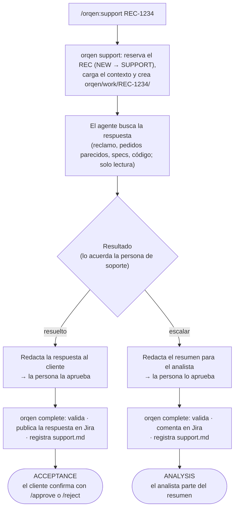
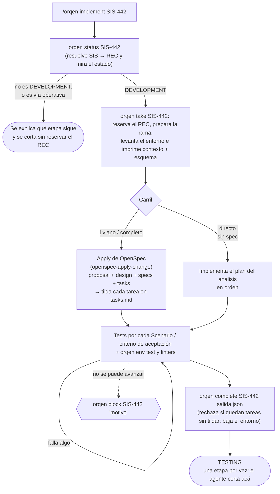
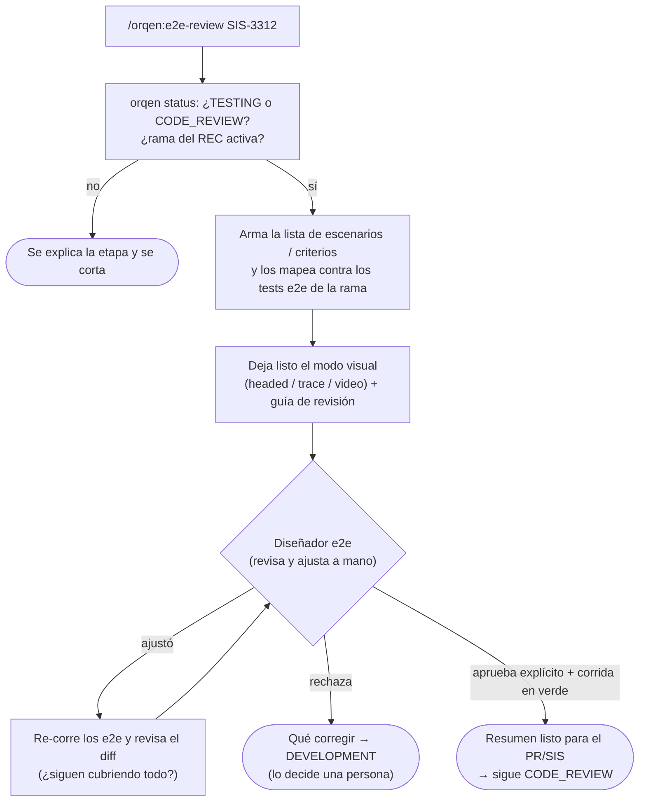
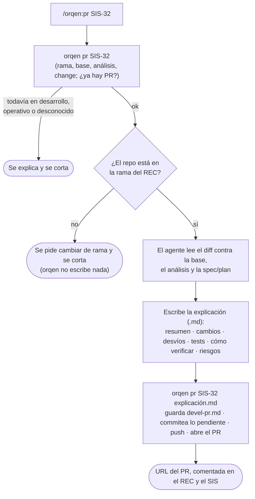
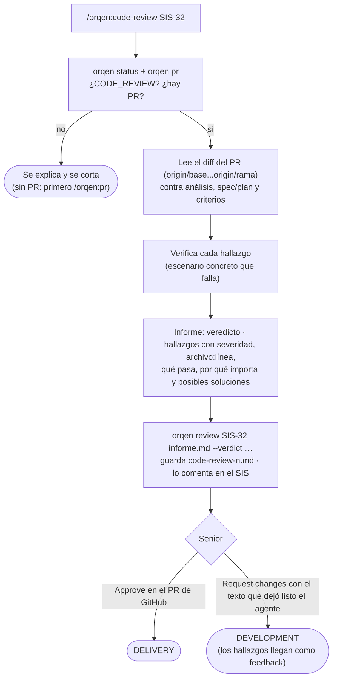
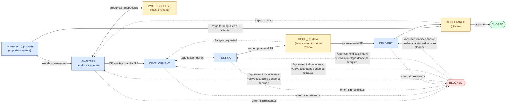

# orqen — AI Software Factory KIT

**orqen** es un kit de orquestación multiagente y automatización del desarrollo de software, diseñado para coordinar el ciclo de vida de los proyectos desde la definición de requerimientos hasta su implementación y entrega.

Construido como una capa superior a OpenSpec, integra agentes especializados de inteligencia artificial, repositorios de código, herramientas de desarrollo, reglas de ingeniería y bases de conocimiento en un ecosistema unificado.

Su arquitectura permite que múltiples agentes colaboren de manera coordinada en actividades de análisis, planificación, desarrollo, pruebas, validación y mantenimiento, bajo mecanismos de gobernanza, supervisión y trazabilidad.

Uno de sus pilares es el aprendizaje continuo a partir de la experiencia: aprovechar los resultados de desarrollos anteriores para enriquecer una base de conocimiento reutilizable y mejorar progresivamente los procesos de trabajo.

Opcionalmente, una persona de **soporte** atiende primero el reclamo con el agente (`/orqen:support REC-1234`) e intenta responderle al cliente. Si no alcanza, lo escala al analista. El análisis lo conduce un **analista** con el agente (`/orqen:analyze REC-1234`); el resto lo lleva el agente con aprobaciones humanas.

| Quién              | Qué corre                                                                                                        |
| ------------------ | ---------------------------------------------------------------------------------------------------------------- |
| Soporte (opcional) | `/orqen:support REC-1234`: busca la respuesta, la redacta para el cliente y, si no se puede resolver, escala al analista con un resumen |
| Analista           | `/orqen:analyze REC-1234`: analiza el REC, elige el carril, escribe la spec si hace falta y crea el SIS en Jira   |
| Agente             | `/orqen:implement SIS-442`: implementa la spec o el plan aprobado · `/orqen:pr SIS-442`: abre el PR a desarrollo |
| Diseñador de e2e   | `/orqen:e2e-review SIS-442`: valida visualmente los tests e2e                                                     |
| Senior             | `/orqen:code-review SIS-442`: revisa el PR con el agente y después aprueba o pide cambios en GitHub               |
| Modo desatendido   | `orqen cycle --loop`: avanza los gates y lanza las etapas de agente pendientes                                   |
| Aprobadores (Jira) | `/approve` o `/reject <motivo>` en el issue (conformidad del cliente, carril operativo, destrabar un BLOCKED)    |

## Componentes

- **CLI `orqen`** (paquete npm, Node ≥ 20.12): maneja la máquina de estados, Jira, git, los PRs, los entornos de prueba y OpenSpec.
  Es determinística: el agente produce contenido y `orqen` decide el flujo.
- **`AGENTS.md` / `CLAUDE.md`**: lo que lee el agente. Explican el proceso y las reglas, y le indican que use la CLI.
- **Plugin de Claude Code** (`orqen/plugin/`): los comandos `/orqen:support`, `/orqen:analyze`, `/orqen:implement`, `/orqen:e2e-review`, `/orqen:pr` y `/orqen:code-review`, y el skill `orqen:grilling`.
- **`orqen/stages/`**: las guías de cada etapa (soporte, análisis, especificación, desarrollo, testing, entrega, ejecución y verificación). Se pueden editar.
- **`orqen/work/<KEY>/`**: registro y estado de cada REC dentro del repo (lo escribe `orqen`).
- **`openspec/config.yaml`**: reglas del proceso REC aplicadas a los artefactos de OpenSpec.

## Soporte (opcional): `/orqen:support REC-1234`

Es la etapa **antes del analista**: la persona que recibe el reclamo intenta responderle al cliente sin llegar a un análisis ni a
un desarrollo. `SUPPORT_STAGE` (en `orqen/.env`, apagada por defecto) solo decide si `orqen pending` manda los REC nuevos a soporte: con `on` aparecen primero ahí; con `off`, el flujo es el de siempre
(`NEW` → `ANALYSIS`).



**Quién y cómo.** La conduce una persona de soporte con el agente, igual que el análisis con el analista: el agente propone, la
persona decide. `orqen complete` rechaza la salida si falta el **OK explícito** de la persona (`support_ok`) sobre el resultado y sobre
el texto exacto que le llegará al cliente. No hay una lista de personas de soporte: puede tomarlo cualquiera.

| Resultado  | Cuándo                                                                                                                       | Qué pasa                                                                                                                                                       |
| ---------- | ---------------------------------------------------------------------------------------------------------------------------- | -------------------------------------------------------------------------------------------------------------------------------------------------------------- |
| `resolved` | Se responde sin tocar código, datos ni configuración: una consulta de uso, una causa y solución conocidas, algo ya documentado | `orqen` publica la respuesta y el REC pasa a **ACCEPTANCE**. **No se crea SIS.** Si el cliente hace `/reject <motivo>`, abre la ronda 2 y lo toma el analista |
| `escalate` | Pide algo nuevo, es un defecto que requiere código, una corrección de datos o de configuración, o no hay certeza de la respuesta | El REC pasa a **ANALYSIS** con el `escalation_summary` (qué se sabe, qué se probó, qué falta). Se puede mandar además un acuse breve al cliente (opcional)    |

Ante la duda, **escalar**: una respuesta equivocada le cuesta una ronda al cliente; una escalación de más le cuesta unos minutos al
analista. El agente nunca promete fechas, alcance ni cambios al cliente.

**Qué no cambia.**

- El analista puede tomar un REC `NEW` directamente con `orqen analyze`, sin pasar por soporte. También puede tomar uno en `SUPPORT`
  que nadie esté atendiendo; si hay una sesión de soporte activa, `orqen` se lo impide.
- El agente no escribe en Jira: los comentarios los publica `orqen` en `complete`, solo con el OK de la persona.
- Es una etapa de persona: `orqen cycle` (modo desatendido) nunca la toma.

**Qué queda registrado.** `orqen/work/REC-1234/round-1/support.md` (resultado, qué se revisó, respuesta al cliente y escalación) y
`support.json` (la salida validada). Cuando el analista abre el REC escalado, recibe todo eso en `previous_stages.SUPPORT`, y la guía de
análisis le indica partir de ahí en vez de repetir el trabajo. La guía de la etapa está en `orqen/stages/support.md` y se puede editar.

`orqen pending` lista los REC para soporte aparte de los del analista y los del agente. Un REC resuelto por soporte no tiene rama, así que su
registro en `orqen/work/` no se commitea solo (como pasa con el carril operativo).

## Análisis: `/orqen:analyze REC-1234`


El agente **no escribe en Jira** (el MCP es solo lectura): la creación del SIS, el vínculo `SIS ↔ REC`, los comentarios y los
labels los hace `orqen` en `complete`, solo si el análisis tiene el OK del analista y la spec (si hay) valida.

### Carriles

| Carril                           | Cuándo (guía; ajustable en `orqen/stages/analysis.md`)                                 | Qué se genera                                                                                            |
| -------------------------------- | -------------------------------------------------------------------------------------- | -------------------------------------------------------------------------------------------------------- |
| `direct`                         | Un componente, ≲ 4 h, sin cambio de contrato, bajo riesgo                              | **Sin OpenSpec.** `plan` + criterios de aceptación en el análisis y el SIS. Testing contra los criterios |
| `light`                          | Comportamiento observable acotado, 1–2 capacidades, ≲ 2 días                           | Change de OpenSpec compacto: proposal + deltas + tasks (design mínimo)                                   |
| `full`                           | Varias capacidades, datos/integraciones, seguridad/facturación, > 2 días, arquitectura | Change completo: proposal + specs + design + tasks                                                       |
| operativa (`route: operational`) | Se resuelve sin cambiar código (SQL, datos, reinicio, config)                          | Sin spec ni rama; flujo EXECUTION → aprobación → aplicación → verificación                               |

### Qué queda en `orqen/work/REC-1234/`

```
orqen/work/REC-1234/
├── state.json             proyección del estado (state, lane, sis, branch, change, analyst)
├── log.md                 una línea por transición
└── round-1/
    ├── support.md         (solo con soporte) resultado, qué se revisó, respuesta al cliente y escalación
    ├── support.json       la salida validada de soporte
    ├── analysis.md        resumen, criterios, decisiones del grilling, carril y justificación, SIS, estimación
    ├── analysis.json      la salida validada de la etapa
    ├── devel-pr.md        explicación del PR a desarrollo (orqen pr)
    ├── code-review-1.md   informes del code review para el senior (orqen review), uno por review
    └── execution/         (solo carril operativo) script.sql, pasos, rollback, verificación
```

Se commitea con la rama del REC (`orqen` commitea el registro en cada transición mientras esa rama está activa), así la
trazabilidad viaja con el código y la spec. La **fuente de verdad operativa** está en `orqen/state/` (ignorado por git);
`orqen/work/` es la proyección legible. Cada ronda nueva (rechazo de conformidad) agrega `round-2/`, etc.

## Implementación: `/orqen:implement SIS-442`

Toma el SIS que creó el análisis y ejecuta la etapa **DEVELOPMENT**: aplica la spec de OpenSpec si el carril la tiene
(`light` / `full`) o sigue el `plan` del análisis (`direct`). Acepta la key del SIS o la del REC; `orqen` resuelve a qué REC
pertenece (el SIS vigente de la ronda actual).



El agente usa Jira solo para leer y no hace `git commit/push/checkout`, ni `openspec archive`, ni toca `orqen/state/`, `orqen/work/` ni la
configuración de `orqen`. Si el contexto trae un test fallido o un rechazo de revisión (`human_feedback`), se corrige eso primero.

## Testing

Es una etapa del agente, sin intervención humana. `orqen take` levanta todos los procesos del proyecto (también el front), corre la suite configurada y los corta.
El agente mapea **cada Scenario** (carril directo: cada **criterio de aceptación**) contra el test que lo verifica, y `orqen` decide:
aprueba solo si la suite pasó y todo está cubierto. Si no, vuelve a DEVELOPMENT; al tercer intento fallido pasa a BLOCKED.

**Testing no abre ningún PR**: al aprobar, el REC pasa a CODE_REVIEW y el PR se abre con `/orqen:pr`.

## Revisión de e2e: `/orqen:e2e-review SIS-3312`

Los tests e2e se generan durante la implementación a partir de los Scenarios / criterios de aceptación. Este comando deja todo
listo para que el **diseñador de testing e2e** (una persona) los valide **visualmente** y **espera su aprobación**, con los ajustes
que haga a mano. No mueve el estado del REC (no hace `take` ni `complete`): se corre con el REC en `TESTING` o `CODE_REVIEW`,
parado en la rama del REC, y acepta la key del SIS o la del REC.



El agente **no edita los tests**: señala observaciones (escenarios sin e2e, tests que no verifican el THEN, esperas fijas) y el
diseñador decide. La aprobación la da la persona en la conversación; igual que el OK del analista, **`orqen` no puede comprobarla**
(barrera de proceso, no de seguridad). Los ajustes quedan sin commitear en la rama del REC: `orqen pr` los commitea y los empuja
con el PR a desarrollo (si el PR ya existía, hay que volver a correr `/orqen:pr` para sumarlos).

## PR a desarrollo: `/orqen:pr SIS-32`

Manda la rama del REC a la rama de integración (`DEVEL_BRANCH`, por defecto `desarrollo`) con un pull request cuya
descripción explica los cambios. Acepta la key del SIS o la del REC y se corre con el REC en `TESTING` o después (no en carril operativo).
Es el **único PR** del proceso: el senior hace el code review (CODE_REVIEW) sobre este PR.



El agente solo redacta: el commit, el push y el PR los hace `orqen` (`DEVEL_PR_COMMAND`, con `{base}`, `{branch}`, `{key}`, `{title}`, `{body}`).
La explicación queda en `orqen/work/<KEY>/round-N/devel-pr.md`. Es idempotente: si el PR ya existe, solo empuja los commits nuevos.
Como `orqen` commitea lo pendiente de la rama antes de empujar, los ajustes manuales (p. ej. los del diseñador de e2e) viajan con el PR.
Si el repo no está en la rama del REC, `orqen pr` falla antes de escribir, commitear o empujar nada.

## Code review: `/orqen:code-review SIS-32`

Lo corre el **senior** con el REC en `CODE_REVIEW` y el PR a desarrollo ya abierto. El agente revisa el diff del PR contra lo pedido
(análisis, spec o plan, Scenarios / criterios de aceptación, explicación del PR y convenciones del repo) y le devuelve un informe para decidir.
No mueve el estado: la decisión la toma el senior con un review en el PR de GitHub (ver más abajo).



Es **solo lectura**: el agente no corrige código, no comenta ni aprueba el PR (solo `gh pr view` / `gh pr diff`) y no escribe en Jira.
Cada hallazgo tiene severidad (`blocking`, `important`, `minor` o `to verify`) y una a tres soluciones posibles, con la recomendada primero.
Si el veredicto no es aprobable, el agente deja redactado el texto del pedido de cambios.

Cuando el senior da el informe por cerrado, el agente lo registra con `orqen review <KEY> <informe.md> --verdict <approve|minor|reject>`
(solo en `CODE_REVIEW` y con el PR abierto). Queda en `orqen/work/<KEY>/round-N/code-review-<n>.md` (numerado: un segundo review después
de un pedido de cambios no pisa al primero), se commitea si el repo está en la rama del REC (viaja con el próximo push) y se comenta en el SIS.

### Cómo se decide el gate: review en GitHub

Con `CODE_REVIEW_GATE=github` (el valor por defecto) el senior **no necesita comentar nada en Jira**: aprueba o pide cambios con un review en el PR,
y `orqen` lo lee con `gh` en cada `orqen pending` / `orqen cycle`:

- **Approve** → el REC pasa a DELIVERY y se comenta en el REC y el SIS.
- **Request changes** → vuelve a DEVELOPMENT y el texto del review llega al agente como feedback (si no tiene texto, se le indica el PR).
- Si hay un approve y un request changes a la vez, **gana el pedido de cambios**.
- Solo cuentan los reviews hechos sobre el **commit actual del PR**: si después del review alguien empuja (por ejemplo `/orqen:pr` con ajustes de e2e), hace falta un review nuevo. Es lo mismo que "dismiss stale approvals" de GitHub, y conviene activarlo también en la protección de rama.
- Cada review se aplica **una sola vez**, así que un pedido de cambios viejo no devuelve el REC a DEVELOPMENT por segunda vez.
- Con `GITHUB_REVIEWERS` definido (usuarios de GitHub, separados por coma), solo cuentan los reviews de esos usuarios; vacío = cualquiera. Para que además nadie más pueda mergear, usá la protección de rama de GitHub. `APPROVERS_CODE` (cuentas de Jira) sigue sirviendo para destrabar un REC BLOCKED.
- Sin PR todavía, el REC espera. Si `gh` falla o no hay red, también espera (no se bloquea).

Con `CODE_REVIEW_GATE=jira` el senior decide con `/approve` o `/reject <motivo>` en el issue, como antes (ahí `APPROVERS_CODE` limita quién puede decidir).

## Flujo completo



**Azul**: etapas del agente · **Amarillo**: gates humanos en Jira · **Rojo**: bloqueado (lo destraba una persona).
Jira, git, PR y `openspec archive` los ejecuta solo `orqen`; el agente produce contenido.

| Estado         | Quién             | Qué pasa                                                                                                      | OpenSpec                                                                                                                                                      |
| -------------- | ----------------- | ------------------------------------------------------------------------------------------------------------- | ------------------------------------------------------------------------------------------------------------------------------------------------------------- |
| SUPPORT        | soporte + agente  | opcional: busca la respuesta y la redacta con la persona. **Resuelto** → ACCEPTANCE (sin SIS); **escalar** → ANALYSIS con el resumen | —                                                                                                                                                             |
| ANALYSIS       | analista + agente | grilling → OK → carril → spec (si corresponde) → SIS vinculado al REC                                         | lee `openspec/specs`; liviano/completo: `orqen lane` crea el change y `orqen complete` exige `validate --strict`, artefactos completos y `(Nh)` en cada tarea |
| WAITING_CLIENT | cliente           | responde en Jira (máx. 3 rondas)                                                                              | —                                                                                                                                                             |
| DEVELOPMENT    | agente            | implementa con el entorno levantado; con spec tilda `tasks.md`, en directo sigue el `plan`                    | flujo _apply_; `orqen` rechaza si queda alguna tarea sin tildar                                                                                               |
| TESTING        | `orqen` + agente  | `orqen` corre la suite y el agente mapea test ↔ **cada Scenario** (directo: cada **criterio de aceptación**). No abre PR | si falta alguno, se rechaza                                                                                                                         |
| CODE_REVIEW    | senior            | revisa el PR a desarrollo (`/orqen:pr`) con el informe de `/orqen:code-review` y decide con un review en GitHub | —                                                                                                                                                             |
| DELIVERY       | `orqen` + agente  | `orqen` archiva (si hubo spec) y el agente escribe notas y mensaje al cliente                                 | `openspec archive` fusiona los deltas en `openspec/specs` y se empuja a la rama del PR                                                                       |
| ACCEPTANCE     | cliente           | `/approve` cierra; `/reject` abre la ronda 2 (vuelve a ANALYSIS: nuevo carril, change y SIS)                  | nuevo change `…-r2`                                                                                                                                           |

Si se agotan los reintentos o hay un error, el REC pasa a **BLOCKED**. Una persona destraba con `/approve <indicaciones>`
(`APPROVERS_ANALYSIS` + `APPROVERS_CODE`): el REC vuelve a la etapa en la que se bloqueó, con los contadores de reintentos en cero
y las indicaciones como feedback para el agente.

**Carril operativo.** Si el REC se resuelve sin cambiar código, el flujo es
`ANALYSIS → EXECUTION → EXECUTION_APPROVAL → APPLICATION → VERIFICATION → ACCEPTANCE → CLOSED`: el agente propone el script, el rollback
y la verificación; una persona de `APPROVERS_EXECUTION` autoriza y aplica, y el agente verifica en solo lectura. Si la verificación muestra
que la causa es de código, el REC vuelve a ANALYSIS y nace un SIS de desarrollo.


## Crear un proyecto nuevo: `orqen create project`

Arma un repo desde cero, con el código base, los scripts que levantan sus entornos y orqen ya listo para los agentes:

```sh
orqen create project "Plataforma de Pagos"                          # pregunta el stack y los datos
orqen create project "Facturación" --stack java-tomcat-sqlserver --dir ./facturacion
orqen create stacks                                                 # lista los stacks disponibles
```

1. Pregunta el nombre, la carpeta y el **stack**: `vue-node-postgres` (Vue 3 + API Node/Express + PostgreSQL) o
   `java-tomcat-sqlserver` (Java 17 en Tomcat 10 + SQL Server).
2. Revisa los requisitos (Node, Maven, Docker…) y pide los parámetros del stack (puertos, paquete Java); si un puerto está
   ocupado propone el siguiente libre.
3. Crea la carpeta y el repo git, genera el código (generadores oficiales, como `create-vue`, más un esqueleto propio con
   health check, migraciones y tests de ejemplo) y copia a `orqen/tools/` el script de la base (`orqen/tools/db.mjs`, PostgreSQL o
   SQL Server en Docker).
4. Corre `orqen init` con el stack y los entornos ya definidos (sin detección ni IA): OpenSpec, Jira, `AGENTS.md`, plugin.
5. Ofrece el commit inicial.

Después: `cd <carpeta>`, `orqen env up` (base + backend + migraciones; `--all` también el front) y `orqen env test`.
Los stacks viven en [`tools/`](tools/README.md): cada uno es una carpeta con su `tool.yaml` y su esqueleto, y se pueden agregar más.

## Instalación en un repo

```sh
npm i -g orqen          # o: pnpm add -g orqen (Node ≥ 20.12)
cd mi-repo
orqen init
```

`orqen init`:

1. Verifica Node, git y el gestor de paquetes.
2. Detecta componentes, cómo se levanta cada uno y qué servicios necesita (`package.json`, `pom.xml`, `pyproject.toml`, Prisma, `.env.example`) y,
   si hay un agente de IA instalado, le pide que revise un resumen del repo (`--deep` para que lo explore entero, `--no-ai` para solo detección automática).
3. Te deja confirmar o editar componentes, el comando que levanta cada parte (`npm run dev`, `npm start`…), tests, migraciones y seeds.
4. Instala OpenSpec (2.x) si hace falta y corre `openspec init` para las herramientas elegidas.
5. Pide la conexión a Jira, los proyectos REC y SIS y los aprobadores, y los guarda en `orqen/.env` (ignorado por git).
6. Escribe la configuración del entorno (sin Docker de por medio), `AGENTS.md` / `CLAUDE.md`, el plugin, las guías de etapa y el manifiesto,
   y fusiona las reglas del proceso con el `openspec/config.yaml` existente.

Opciones: `--yes` (no interactivo), `--agent "<comando>"`, `--tools claude,codex`, `--no-openspec`.

**Plugin para Claude Code** (da los comandos `/orqen:*` y el skill de grilling), una vez por usuario:

```
/plugin marketplace add ./
/plugin install orqen@orqen
```

Recomendado: conectar también el MCP de Atlassian/Jira para que el grilling lea el REC y los relacionados. Es solo lectura:
las escrituras las hace `orqen` con `JIRA_TOKEN`.

**Actualizar** una instalación: `orqen update` busca una versión nueva de la CLI, de OpenSpec y del kit. Los archivos que no editaste se
actualizan solos; para los editados elegís conservar, reemplazar o dejar una copia `.orqen-new`. `--no-cli`, `--no-openspec` y `--no-kit` saltean pasos.

### Qué queda en el repo

| Ruta                             | Para qué                                                                                       |
| -------------------------------- | ---------------------------------------------------------------------------------------------- |
| `orqen/config.yaml`              | Stack, cómo se levanta cada parte, migraciones, tests, rama base y configuración del agente    |
| `orqen/.env`                     | Credenciales de Jira, proyectos y aprobadores (local, ignorado por git)                        |
| `orqen/stages/`                  | Guías de cada etapa (editables)                                                                |
| `orqen/plugin/`                  | Comandos de Claude Code y el skill de grilling                                                 |
| `orqen/work/<KEY>/`              | Registro versionado de cada REC                                                                |
| `orqen/state/` y `orqen/tmp/`    | Estado operativo, procesos corriendo y sus logs (ignorados por git)                            |
| `orqen/manifest.json`            | Hashes de los archivos del kit, para que `orqen update` detecte tus cambios                    |
| `AGENTS.md` y `CLAUDE.md`        | Instrucciones del proceso para los agentes                                                     |
| `openspec/`                      | Specs y configuración de OpenSpec                                                              |

### Variables principales de `orqen/.env`

| Variable                                                     | Para qué                                                                                   |
| ------------------------------------------------------------ | ------------------------------------------------------------------------------------------ |
| `JIRA_URL`, `JIRA_USER`, `JIRA_TOKEN`, `JIRA_DEPLOYMENT`      | Conexión a Jira (`cloud` o `server`)                                                       |
| `REC_JQL`                                                    | Qué REC procesa `orqen`                                                                    |
| `SUPPORT_STAGE`                                              | `on`: `orqen pending` manda los REC nuevos primero a soporte. Por defecto `off`; `/orqen:support` funciona con cualquiera de los dos valores. No hay lista de personas de soporte: puede tomarlo cualquiera |
| `SIS_PROJECT`, `SIS_TYPE`, `SIS_LINK`, `SIS_TYPE_OPERATIONAL` | Cómo se crea y vincula el SIS                                                              |
| `JIRA_TRANSITIONS`, `SIS_TRANSITIONS`                        | Transiciones de Jira por estado                                                            |
| `APPROVERS_ANALYSIS`, `APPROVERS_CODE`, `APPROVERS_CLIENT`, `APPROVERS_EXECUTION` | Quién puede decidir en cada gate de Jira, con cuentas de Jira (vacío = cualquiera). `APPROVERS_CODE` también destraba un BLOCKED |
| `CODE_REVIEW_GATE`, `GITHUB_REVIEWERS`                       | Quién decide en CODE_REVIEW: `github` (review en el PR, por defecto) o `jira` (`/approve` y `/reject`). `GITHUB_REVIEWERS`: usuarios de GitHub cuyos reviews cuentan (vacío = cualquiera) |
| `BASE_BRANCH`, `TEST_COMMAND`                                | Rama base de las ramas de REC y suite por defecto (si `config.yaml` no define tests)       |
| `DEVEL_BRANCH`, `DEVEL_PR_COMMAND`                           | Rama de integración y comando que abre el PR (`orqen pr`)                                  |
| `AGENT_CMD`, `REC_INTERVAL_SEC`, `REC_LOCK_MIN`              | Agente del modo desatendido, intervalo del ciclo y vencimiento del lock por REC            |

## Entornos y tests

Cada parte del proyecto se levanta con su propio comando, sin Docker de por medio (si un equipo lo quiere, un proceso puede ser
`docker compose up db`). `orqen init` lo propone y lo deja en `orqen/config.yaml`:

```yaml
entornos:
  procesos:
    - nombre: api
      comando: npm run dev        # o npm start, mvn spring-boot:run, dotnet watch run…
      ruta: apps/api
      puerto: 3000                # listo cuando el puerto responde (o `url:` / `listo_si: "texto del log"`)
      cuando: siempre             # siempre: para desarrollar y testear · e2e: solo para tests e2e / visuales
    - nombre: web
      comando: npm run dev
      ruta: apps/web
      puerto: 5173
      cuando: e2e
  variables: { DATABASE_URL: postgresql://localhost:5432/pagos }
  preparar: [pnpm install]
  migrar: [npx prisma migrate deploy]
  tests: { unitarios: pnpm test, e2e: pnpm exec playwright test }
```

- En **DEVELOPMENT**, `orqen take` instala dependencias, levanta los procesos de `cuando: siempre` en segundo plano, espera a
  que respondan y corre migraciones y seeds. El agente recibe en `environment` el estado, las variables y los comandos de test.
  `orqen complete` los corta.
- En **TESTING**, `orqen` levanta todos los procesos (también los de e2e), corre toda la suite configurada y los corta.
- Si un proceso no levanta, el agente ve el final de su log (`orqen/state/logs/<proceso>.log`) y lo corrige o te pregunta.

```sh
orqen env setup                                    # instala dependencias
orqen env up [--all]                               # procesos + migraciones + seeds (--all: también los de e2e)
orqen env test [unitarios|integracion|e2e|visual]
orqen env status                                   # qué está corriendo y dónde está su log
orqen env down                                     # corta lo que levantó orqen
```

## Con la persona en el medio

orqen acompaña a la persona, no la reemplaza. Mientras haya alguien del otro lado (`/orqen:analyze`, `/orqen:implement`,
`/orqen:pr`, los reviews), el agente:

- cuenta qué va a hacer y espera el OK antes de cada paso importante (carril, spec, plan, cambios fuera del plan, abrir el PR,
  cerrar la etapa) y, al terminar cada paso, cuenta qué hizo y qué sigue;
- ante cualquier duda pregunta, con opciones concretas y su recomendación, en vez de suponer.

En modo desatendido (`orqen cycle`) nadie puede contestar: una duda que cambia el resultado se convierte en `orqen block` con la
pregunta, que orqen publica en Jira; la persona responde con `/approve <respuesta>` y el agente sigue con esa respuesta.

## Enjambre: `orqen swarm`

Para una tarea de cualquier tipo que se pueda partir: orqen la divide en subtareas chicas, las resuelve en paralelo con modelos
chicos y junta todo en una rama.

```sh
orqen swarm "Agregar exportación a CSV en el listado de pagos, con filtros por fecha y tests"
orqen swarm --file tarea.md --parallel 6
orqen swarm "…" --plan-only          # solo el plan (orqen/state/swarm/<run>/plan.json), para revisarlo o editarlo
orqen swarm --plan plan.json         # corre un plan ya revisado
```

1. **Plan**: un modelo grande (`--planner`, por defecto Opus) lee el repo y devuelve un grafo de subtareas: archivos que toca
   cada una, dependencias, criterios y un `test` rápido que solo pasa cuando la subtarea está hecha. orqen valida el plan (ids,
   ciclos, y que dos subtareas que pueden correr a la vez no toquen el mismo archivo) y, si no cierra, se lo devuelve con los
   errores una vez.
2. **OK de la persona**: muestra el plan y pregunta antes de lanzar (`--yes` o sin terminal: sigue solo).
3. **Workers en paralelo**: cada subtarea corre en su propio `git worktree` (tu checkout no se toca), hasta `--parallel` a la vez
   (4 por defecto). Las que dependen de otras arrancan cuando esas ya están mergeadas, encima del código mergeado. En cada
   worktree nuevo corre `entornos.preparar` (o `--setup`).
4. **Verificación y escalado**: después de cada intento orqen corre el `test` de la subtarea. Si falla, resetea el worktree y
   reintenta pasándole al modelo la salida del error. El modelo chico (`--small`, Haiku) tiene 2 intentos; si no lo resuelve,
   la subtarea pasa al grande (`--large`, Sonnet) con 2 intentos más. Las marcadas `complex` en el plan arrancan en el grande.
5. **Merge**: cada subtarea que pasa se commitea y se mergea (`--no-ff`) a la rama `orqen/swarm-<run>`. Si choca con algo
   mergeado mientras tanto, se rehace encima de lo último (cuenta como intento).
6. **Test final**: con todo mergeado corre el `finalTest` del plan (o `--test` / `entornos.tests.unitarios`). Si falla, el
   modelo grande lo arregla sobre la rama de integración (hasta 2 veces).

Al terminar quedan la rama `orqen/swarm-<run>` lista para revisar y mergear (`git merge orqen/swarm-<run>` o un PR), y el
informe con cada intento, modelo y log en `orqen/state/swarm/<run>/`. Si una subtarea no se resuelve con ningún modelo, las que
dependen de ella se saltean, el resto se mergea igual y el comando sale con código 1. Los worktrees se borran al final
(`--keep` deja el de integración).

Los modelos son comandos headless, así que se puede usar cualquier agente: `--small "codex exec --full-auto -"`,
`--large "claude -p --model opus --permission-mode acceptEdits"` (o `ORQEN_SWARM_SMALL`, `ORQEN_SWARM_LARGE`,
`ORQEN_SWARM_PLANNER`). Con `{prompt}` en el comando, el prompt va como argumento en vez de stdin.

## Uso

**Soporte (opcional)**: en Claude Code, `/orqen:support REC-1234`. En otro agente: _"atendé el REC-1234 como soporte"_ (`orqen support` → búsqueda → `orqen complete`). Si resuelve, `orqen` publica la respuesta y el cliente confirma con `/approve` o `/reject <motivo>`; si escala, el analista parte del resumen. El analista también puede tomar un REC nuevo directo con `analyze`. `support` funciona aunque `SUPPORT_STAGE` esté en `off`: sirve para pasar un REC puntual por soporte sin cambiar el flujo del resto.

**Análisis (analista)**: en Claude Code, `/orqen:analyze REC-1234`. En otro agente: _"analizá el REC-1234"_ (el agente lee
`AGENTS.md` y corre `orqen analyze` → grilling → `orqen lane` → `orqen complete`).

**Implementación**: en Claude Code, `/orqen:implement SIS-442`. En otro agente: _"implementá el SIS-442"_ (`orqen status` → `orqen take` →
apply de la spec o plan → `orqen complete`).

**Validación de e2e**: en Claude Code, `/orqen:e2e-review SIS-3312`, a cargo del diseñador de testing e2e. En otro agente: _"preparame la revisión de e2e del SIS-3312"_.

**PR a desarrollo**: en Claude Code, `/orqen:pr SIS-32`. En otro agente: _"abrí el PR a desarrollo del SIS-32"_ (`orqen pr` → explicación → `orqen pr <KEY> <archivo.md>`).

**Code review**: en Claude Code, `/orqen:code-review SIS-32`, a cargo del senior. En otro agente: _"hacé el code review del PR del SIS-32"_.

**Resto de las etapas, interactivo**: _"procesá el REC REC-123"_ → `orqen take` → trabaja → `orqen complete`.

**Desatendido** (cron, CI o servidor), solo etapas de agente — **nunca** SUPPORT ni ANALYSIS:

```sh
orqen cycle --loop     # cada REC_INTERVAL_SEC: avanza gates y lanza AGENT_CMD por REC pendiente
```

Para cambiar de agente alcanza con cambiar `AGENT_CMD`, por ejemplo a `codex exec --full-auto {prompt}`.
Los REC nuevos no se toman solos: quedan en NEW hasta que soporte corre `support` o un analista corre `analyze` (con `SUPPORT_STAGE=on`, `orqen pending` los lista primero para soporte).

### Comandos

```text
orqen init [dir]                       Inicializa un repo
orqen update [dir]                     Actualiza la CLI, OpenSpec y el kit

orqen create project [nombre] [--stack <id>] [--dir <carpeta>] · orqen create stacks
orqen env setup | up [--all] | test [tipo] | status | down
orqen swarm "<tarea>" [--parallel N] [--plan-only | --plan plan.json] [--small C] [--large C] [--yes]

orqen pending [--json]                 REC con trabajo: para soporte / para analizar / para un agente
orqen support <KEY> [--person N]       Abre la atención de soporte (anda con SUPPORT_STAGE on u off)
orqen analyze <KEY> [--analyst N]      Abre el análisis con un analista
orqen lane <KEY> <direct|light|full>   Registra el carril (light/full: rama + change de OpenSpec)
orqen take <KEY> [--agent N]           Reserva una etapa de agente y prepara rama y entorno
orqen complete <KEY> <salida.json|->   Valida la salida de la etapa y avanza el proceso
orqen pr <KEY> [<explicación.md>] [--title T]                     Sin archivo: informa. Con archivo: commit + push + PR a DEVEL_BRANCH
orqen review <KEY> <informe.md|-> --verdict <approve|minor|reject> Registra el informe del code review (CODE_REVIEW)
orqen status [KEY]                     Estado actual y log
orqen schema <ETAPA>                   JSON Schema de la salida de una etapa
orqen block <KEY> <motivo>             Escala a una persona
orqen release <KEY>                    Libera la reserva de un REC
orqen search <JQL>                     Busca issues (antecedentes / relacionados)
orqen cycle [--loop]                   Modo desatendido
```

`take`, `complete`, `status`, `block`, `release`, `pr` y `review` aceptan la key del REC o la de su SIS.

## Garantías y límites

- Las salidas se validan con zod y con OpenSpec. Si algo no cumple, el agente recibe la lista de errores y reintenta. Nada avanza a medias:
  el SIS no se crea hasta que el análisis (y la spec) están validados, y si Jira falla a mitad de camino, repetir `complete` retoma sin duplicar.
- El OK del analista es un campo obligatorio de la salida (`analyst_ok`), pero **lo declara el agente**: `orqen` no puede comprobar que la persona
  lo haya dado. Lo mismo pasa con la aprobación del diseñador de e2e. Son barreras de proceso, no de seguridad.
- Hay un lock por REC (vence a los `REC_LOCK_MIN`, pero el mismo agente puede completar igual si nadie más lo tomó, porque el grilling puede ser largo).
- Jira, git, PR y archive los ejecuta **solo** `orqen`. El agente tiene esa prohibición en `AGENTS.md`, pero
  al ser agnóstico **no hay un hook que lo impida a la fuerza**. Hay que reforzarlo con el sandbox o los permisos de
  cada herramienta (por ejemplo, denegar `git push` en `.claude/settings.json`, o permitir del MCP de Jira solo las herramientas de lectura).
- Con `CODE_REVIEW_GATE=github`, sin PR abierto el REC espera en CODE_REVIEW: no avanza hasta que se corra `/orqen:pr` y el senior revise. La aprobación sale de GitHub, así que `orqen` necesita `gh` autenticado; con `jira` el gate sigue aceptando `/approve` aunque no exista el PR.
- El estado vive en `orqen/state/` (ignorado por git, sobrevive a los cambios de rama) y en labels de Jira `rec-state-*`; `orqen/work/<KEY>/` es su proyección versionada.
- Usa un solo checkout, así que procesa un REC por vez por clon. Para trabajar en paralelo: un clon o worktree por agente.

## Desarrollo del kit

- [`cli/`](cli/README.md): la CLI (comandos, máquina de estados, entornos).
- `template/`: los archivos que instala `orqen init`.

```sh
cd cli
npm ci
npm run dev -- --help
npm test          # e2e con OpenSpec y git reales + gates, carriles, SIS y kit con fakes
npm run typecheck
npm run build
npm run setup     # compila y linkea la CLI local como `orqen`
```

El paquete `orqen` publicado incluye los templates. El workflow de release publica desde `cli/` cuando se empuja un tag de versión.
